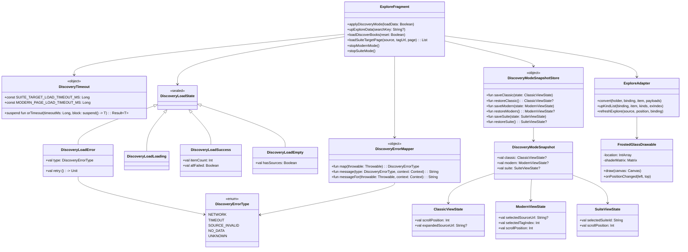
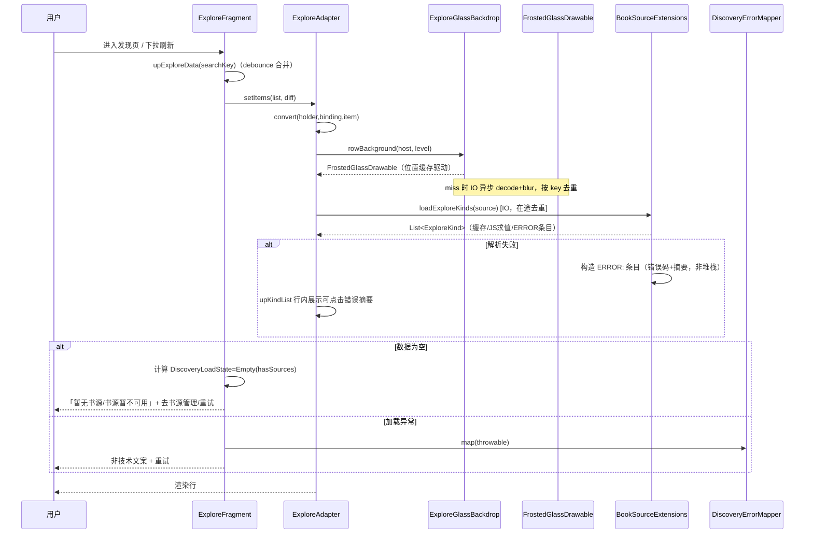
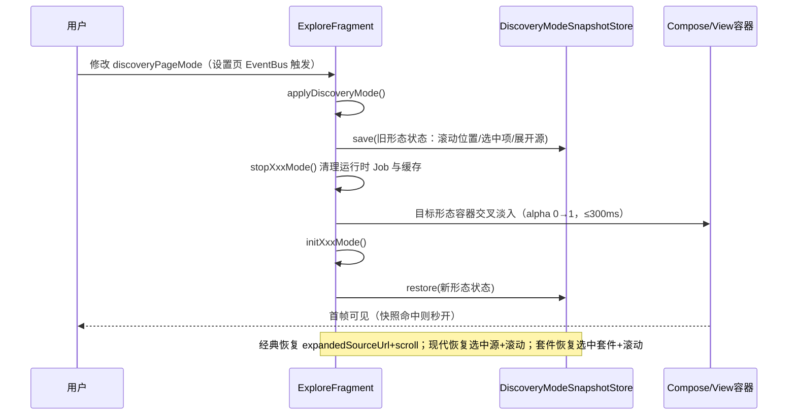
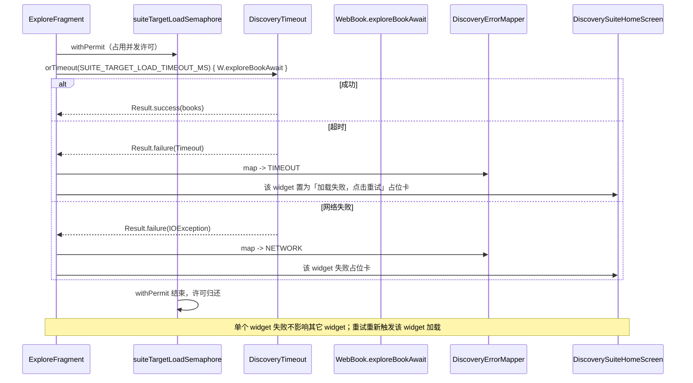

# 发现页使用体验优化 —— 系统设计与任务分解

> 项目：LegadoH（开源阅读类 Android 应用）
> 范围：发现页（Explore）以「经典模式」为主，兼顾经典 / 现代 / 套件三形态衔接与切换体验
> 架构师：高见远
> 性质：系统设计文档（不写实现代码）
> 上游输入：《发现页使用体验优化 PRD》（P0-P2 编号）

---

## 1. 实现方案总览

发现页三形态同驻单 `ExploreFragment`，是「View/XML 与 Compose 混用」的既有事实。本轮优化**不推翻、不重构**，遵循「最小变更 + 复用既有设施 + 抽薄共享层」三条原则，把改动聚焦在四个维度：

| 维度 | 对应 PRD | 方案要点 |
| --- | --- | --- |
| A. 主线程减负 | P0-1、P2-1、P1-3 | 把行绑定的重活（毛玻璃、`exploreKinds`、动态 `viewName`）从主线程可见路径剥离；`FrostedGlassDrawable` 逐帧 `getLocationOnScreen` 改为布局/滚动回调驱动的位置缓存；固定 120ms `delay` 改为 `debounce` |
| B. 异常统一降级 | P0-2、P0-3 | 新增「异常 → 非技术文案」映射层与经典模式「加载状态机」；现代/套件不再向用户暴露 `localizedMessage`，widget 失败给可重试占位卡 |
| C. 超时兜底 | P0-4 | 对发现页所有 `WebBook.exploreBookAwait` 调用统一加可配置超时，超时按失败处理并保证 Semaphore 许可归还 |
| D. 切换与状态 | P1-1、P1-2、P1-4 | 抽「三形态状态快照」模型统一离开/返回恢复；切换加 ≤300ms 交叉淡入；套件首屏补骨架屏 |
| E. 设置衔接 | P2-2 | 补充 `searchKeys` 别名与 summary 互链说明，保证设置搜索命中 |

**取舍说明**：
- **不 Compose 化经典模式**：`rvFind + ExploreAdapter` 是经典模式的核心资产，且 `exploreKinds` 的动态控件行（url/button/text/toggle/select）是 View 体系强项，Compose 化收益低、风险高。本方案保留 View/XML，只做性能与降级优化。
- **不引入新依赖**：超时、debounce、限流、状态流全部用现有 kotlinx.coroutines / Compose / Glide 能力，仅可能使用 `@OptIn(FlowPreview::class)`（协程库自带）。
- **快照模型只做「进程内」**：经典模式已明确「不落盘、重启从头」；现代/套件沿用既有边界（套件保留现有落盘快照 `DiscoverySuitePageSnapshotStore`，现代只做进程内快照），不在本轮扩张跨进程语义（见待明确事项 4）。
- **`ExploreFragment.kt` 仍是枢纽**：三形态编排逻辑不动结构，新增的共享层以 `object` / 顶层函数形式挂在同包，避免大范围改签名。

---

## 2. 框架 / 技术选型

| 关注点 | 选型 | 理由 |
| --- | --- | --- |
| 语言/UI | Kotlin + 传统 View/XML（经典）+ Jetpack Compose（现代/套件） | 贴合现状，不新增范式 |
| 协程/并发 | kotlinx.coroutines：`withTimeoutOrNull`、`Semaphore.withPermit`、`debounce`、`conflate`、`Mutex` | 全为既有设施，超时/限流/debounce 均有现成原语 |
| 状态流 | `StateFlow`/`mutableStateOf`/`mutableStateMapOf` | 现有模式，Compose 侧直接订阅 |
| 数据缓存 | `DiscoverySuiteStore` 解析缓存、`DiscoveryCachePolicy` 512KB、`DiscoverySuitePageSnapshotStore` 快照 | 全部复用，仅在其上扩展现代模式进程内快照 |
| 主题/视觉 | `AppSettingPalette` / `AppDialogStyle` / `ThemeRuntimeKeys.themeExploreGlassBlur()` | 深浅色与毛玻璃强度沿用现规范 |
| 图片 | Glide（封面预载 + 限流） | 不改 |
| 错误映射 | 新建轻量 `object DiscoveryErrorMapper`（纯函数映射） | 无框架依赖，可单测，跨三形态复用 |
| 设备性能分级 | 复用 `AppConfig.isEInkMode` + `ActivityManager.isLowRamDevice`，`themeExploreGlassBlur` 支持「自动」档（值 -1） | 不引入性能检测 SDK |

**是否引入新第三方依赖**：**否**。全部基于现有 `build.gradle` 依赖集。

---

## 3. 文件列表

### 3.1 新增文件

| 相对路径 | 职责 |
| --- | --- |
| `app/src/main/java/io/legado/app/ui/main/explore/DiscoveryErrorMapper.kt` | 异常类型枚举 + 异常→非技术文案映射 + 发现页超时封装（常量与 `withDiscoveryTimeout`） |
| `app/src/main/java/io/legado/app/ui/main/explore/DiscoveryLoadState.kt` | 经典模式加载状态机（`DiscoveryLoadState` sealed）与空/失败/成功语义 |
| `app/src/main/java/io/legado/app/ui/main/explore/DiscoveryModeSnapshot.kt` | 三形态「离开前状态」快照模型 + 进程内快照仓库 `DiscoveryModeSnapshotStore` |

### 3.2 修改文件

| 相对路径 | 涉及 PRD | 改动点 |
| --- | --- | --- |
| `app/src/main/java/io/legado/app/ui/main/explore/ExploreFragment.kt` | P0-2/3/4、P1-1/2/3/4、P2-2 | 加载状态机接入、错误映射、超时、`applyDiscoveryMode` 淡入、快照保存/恢复、`delay`→`debounce`、顶栏直达入口 |
| `app/src/main/java/io/legado/app/ui/main/explore/ExploreAdapter.kt` | P0-1/2、P1-3 | `convert` 减负、`upKindList` 空/错误态、`refreshExplore` 反馈、在途去重 |
| `app/src/main/java/io/legado/app/ui/main/explore/ExploreGlassBackdrop.kt` | P0-1、P2-1 | `FrostedGlassDrawable` 位置缓存驱动 + 自动性能档降级 |
| `app/src/main/java/io/legado/app/ui/main/explore/ExploreModernListScreen.kt` | P0-3、P1-1/2 | 错误态+重试、顶栏视觉对齐 |
| `app/src/main/java/io/legado/app/ui/main/explore/DiscoverySuiteHomeScreen.kt` | P0-3、P1-1/4 | widget 失败占位卡、骨架屏、顶栏视觉对齐 |
| `app/src/main/java/io/legado/app/help/source/BookSourceExtensions.kt` | P0-2 | `exploreKinds` 的 `ERROR:` 条目构造收敛（错误码 + 摘要，不塞 stacktrace 原文） |
| `app/src/main/java/io/legado/app/ui/config/DiscoverySubscriptionConfigFragment.kt` | P2-2 | summary 互链说明 + `searchKeys` 别名 |
| `app/src/main/java/io/legado/app/ui/config/PageLayoutConfigFragment.kt` | P2-2 | summary 说明「布局仅现代模式生效」+ `searchKeys` 别名 |
| `app/src/main/res/values/strings.xml`（及 `values-zh`、`values-zh-rTW`、`values-zh-rHK` 等既有翻译） | P0-2/3 | 新增异常/空态/重试/骨架屏文案 |

> 注：`DiscoverySubscriptionConfigFragment.kt` 实际路径为 `app/src/main/java/io/legado/app/ui/config/`（PRD 索引里写的是旧路径，已核实）。

---

## 4. 数据结构与接口

### 4.1 类图



### 4.2 关键接口说明

- **`DiscoveryErrorMapper.map(e)`**：按 `IOException/SocketTimeoutException` → `NETWORK`；`TimeoutCancellationException`（超时封装主动抛出）→ `TIMEOUT`；`ERROR:` 前缀条目/解析失败 → `SOURCE_INVALID`；空结果 → `NO_DATA`（由状态机判断，非异常）；其余 → `UNKNOWN`。**任何路径都不返回 `e.localizedMessage`**。
- **`DiscoveryLoadState`**：经典模式 `upExploreData` 落地后计算——列表非空→`Success`；空且无书源→`Empty(hasSources=false)`；空且有书源（全失效）→`Empty(hasSources=true)`；异常→`Error(type, retry)`。UI 据此切 `tvEmptyMsg` 文案与按钮，替代现有 `it.isNotEmpty() || query非空` 的单薄判断。
- **`DiscoveryTimeout.orTimeout`**：内部 `withTimeoutOrNull`，返回 `Result`；`null` 映射为 `DiscoveryErrorType.TIMEOUT`。调用点（`loadSuiteTargetPage`、现代单页加载）在 `withPermit` 内包裹，`finally` 语义由 `withPermit` 保证许可释放。
- **`DiscoveryModeSnapshotStore`**：进程级 `object`（类似现有 `classicLastScrollPosition` 顶层变量），存放三种形态离开前状态；现代/套件的滚动位置由各自 `rememberLazyListState` 在 `stopXxxMode` 时读出并保存，返回时 `scrollToItem` 恢复。

---

## 5. 程序调用流程

### 5.1 经典模式加载链路（含异常降级）



### 5.2 三形态切换与状态保持



### 5.3 widget 超时降级链路



---

## 6. 任务列表（有序、含依赖）

> 任务按实现顺序排列；每任务至少覆盖 3 个文件；`ExploreFragment.kt` 被多任务修改，故顺序执行避免合并冲突。

### T01 基础设施与共享能力层
- **PRD**：P0-2 / P0-3 / P0-4（公共底座）、P1-2（快照模型）
- **文件**：
  - 新增 `DiscoveryErrorMapper.kt`
  - 新增 `DiscoveryLoadState.kt`
  - 新增 `DiscoveryModeSnapshot.kt`
  - 修改 `res/values/strings.xml`（及 `values-zh` 等）新增文案 key
- **依赖**：无
- **验收**：三文件编译通过；`DiscoveryErrorMapper.map` 对四类异常返回正确 `DiscoveryErrorType` 且不含原始 `localizedMessage`；`DiscoveryLoadState` 四态可表达经典列表全部场景；`DiscoveryModeSnapshotStore` 可保存/恢复三形态状态；新增字符串资源齐全。

### T02 经典模式滚动性能与异常降级
- **PRD**：P0-1、P0-2、P1-3、P2-1
- **文件**：
  - 修改 `ExploreAdapter.kt`
  - 修改 `ExploreGlassBackdrop.kt`
  - 修改 `ExploreFragment.kt`（`upExploreData`/`initGroupData`/`upKindList`/`refreshExplore`/companion 常量）
  - 修改 `BookSourceExtensions.kt`（`ERROR:` 条目构造）
- **依赖**：T01
- **验收**：
  - `FrostedGlassDrawable` 不再每帧 `getLocationOnScreen`，改由布局/滚动回调驱动位置缓存；
  - `convert` 与 `draw` 主线程路径无可疑长任务（毛玻璃构建/`exploreKinds`/`viewName` 求值均 IO + 在途去重）；
  - `delay(120ms)` 改为 `debounce` 语义，批量增删一次到位、无中间闪跳；
  - 无书源/全部失效/网络失败/超时四类异常有独立非技术文案与重试，`ERROR:` 条目可点击查看摘要、不展示堆栈；
  - 毛玻璃「自动」档按低端/墨水屏降级。

### T03 现代/套件异常降级与超时兜底
- **PRD**：P0-3、P0-4、P1-4
- **文件**：
  - 修改 `ExploreFragment.kt`（`loadDiscoverBooks`/`loadSuiteWidgetBooks`/`loadSuiteRankedListWidgetBooks`/`loadSuiteTargetPage`）
  - 修改 `ExploreModernListScreen.kt`（错误态 + 重试）
  - 修改 `DiscoverySuiteHomeScreen.kt`（widget 失败占位卡 + 骨架屏）
- **依赖**：T01
- **验收**：
  - `loadDiscoverBooks` catch 不再赋 `e.localizedMessage`，改走 `DiscoveryErrorMapper` + 重试；
  - 套件单个 widget 失败展示「该模块加载失败，点击重试」占位，不影响其它 widget；
  - `loadSuiteTargetPage` 与单页加载加超时，超时按失败处理、`withPermit` 许可始终归还（慢源不饿死并发）；
  - 快照未命中时首屏骨架屏 ≤1 帧内出现。

### T04 三形态切换无感化与状态保持
- **PRD**：P1-1、P1-2
- **文件**：
  - 修改 `ExploreFragment.kt`（`applyDiscoveryMode`/`stopModernMode`/`stopSuiteMode`/`classicRememberViewPosition`）
  - 修改 `DiscoverySuiteHomeScreen.kt`（顶栏视觉对齐）
  - 修改 `ExploreModernListScreen.kt`（顶栏视觉对齐）
- **依赖**：T01、T02、T03
- **验收**：
  - 形态切换交叉淡入 ≤300ms、无空白闪烁、无上一形态控件残留；
  - 三形态搜索入口/形态切换入口位置一致；
  - 现代返回恢复选中书源+滚动；套件返回恢复选中套件+滚动；经典返回恢复 `classicExpandedSourceUrl`+`classicLastScrollPosition`；
  - 重启后套件落盘快照、经典不落盘等既定行为不变。

### T05 设置搜索/布局衔接与集成收尾
- **PRD**：P2-2（P2-3 仅预留、不实现）
- **文件**：
  - 修改 `DiscoverySubscriptionConfigFragment.kt`
  - 修改 `PageLayoutConfigFragment.kt`
  - 修改 `ExploreFragment.kt`（顶栏「页面布局」直达入口，可选）
- **依赖**：T04
- **验收**：
  - 搜索「瀑布流/套件/形态/发现页/布局」能命中对应设置项；
  - 两处 summary 互相说明适用范围（布局仅现代模式生效）；
  - 修改后经 `EventBus.UP_PAGE_LAYOUT` / `NOTIFY_MAIN` 即时生效；
  - 全链路回归：经典滚动、三形态切换、异常降级、超时兜底无回归。

---

## 7. 依赖包列表

**无新增第三方依赖。** 本轮全部复用现有依赖，仅使用协程库内置的 `FlowPreview` 注解（`debounce`）：

```
- kotlinx-coroutines（现有）: withTimeoutOrNull / Semaphore / Mutex / debounce(FlowPreview) / conflate
- androidx.compose（现有）: animation / runtime / material3
- androidx.lifecycle（现有）: lifecycleScope / flowWithLifecycleAndDatabaseChange
- Glide（现有）: 封面加载与限流
- GSON（现有）: 缓存序列化
```

若需在 `build.gradle` 显式开启 `-Xopt-in=kotlinx.coroutines.FlowPreview` 编译器参数，属于工程配置级微调，不引入新库。

---

## 8. 共享知识（跨文件约定）

- **命名前缀**：发现页新增符号统一 `Discovery*`；超时常量统一 `*_TIMEOUT_MS` 后缀；错误文案 key 统一 `discovery_error_*`、空态 key 统一 `discovery_empty_*`、套件降级 key 统一 `discovery_suite_*`。
- **错误码（枚举）**：`DiscoveryErrorType { NETWORK, TIMEOUT, SOURCE_INVALID, NO_DATA, UNKNOWN }`，全项目发现页统一使用，禁止在 UI 层拼 `e.localizedMessage`。
- **线程模型**：
  - 主线程只做「轻量 diff + 状态回填 + 视图绑定」；
  - `exploreKinds` / 毛玻璃 bitmap 构建 / `viewName` 求值 / 网络加载一律 `Dispatchers.IO`；
  - 对同一 `bookSourceUrl` 的 `exploreKinds` / `viewName` 求值做「在途去重」（`ConcurrentHashMap`/`Mutex`），避免行复用导致的重复求值与错行。
- **超时常量**（首版建议值，可配置）：`SUITE_TARGET_LOAD_TIMEOUT_MS = 8_000L`、`MODERN_PAGE_LOAD_TIMEOUT_MS = 10_000L`。取值待客户拍板（见待明确事项 3）。
- **并发许可**：现有 `SUITE_WIDGET_LOAD_PARALLELISM / SUITE_TARGET_LOAD_PARALLELISM / SUITE_COVER_PRELOAD_PARALLELISM = 4` 不变；任何包裹 `WebBook.exploreBookAwait` 的超时必须置于 `withPermit` 内，确保许可归还。
- **缓存边界**：`DiscoveryCachePolicy.MAX_SQLITE_VALUE_BYTES = 512KB`、`DiscoverySuiteStore` 解析缓存、`cacheSignature` 签名比对逻辑均不动；新增现代模式快照为**进程内**，不新增落盘。
- **事件总线**：`EventBus.UP_PAGE_LAYOUT`（布局即时生效）、`EventBus.NOTIFY_MAIN`（形态切换即时生效）、`EventBus.MAIN_THEME_BACKGROUND_CHANGED`（经典行换色）保持现状语义。
- **状态流**：`upExploreData` 用 `debounce`（FlowPreview）+ `conflate` + `distinctUntilChanged`，保证「合并窗口内只落地一次、窗口结束立即落地」的最终一致。

---

## 9. 待明确事项（技术侧风险与需确认点）

1. **形态切换入口位置与快捷手势**（PRD 待确认 1）：切换入口放顶栏左侧还是「更多」菜单内，直接决定 T04 顶栏布局改造范围。建议先按「顶栏固定左位」实现，手势后续迭代。
2. **异常文案措辞基调**（PRD 待确认 2）：`SOURCE_INVALID` 与 `NETWORK` 是否细分措辞。方案已按「可细分」设计（枚举已拆开），即使最终统一为「加载失败，点击重试」也只改映射表不改结构。
3. **超时时长**（PRD 待确认 3）：建议 8s/10s。超时过短会误杀「慢但能出结果」的源；需与「慢源观感」权衡。当前作为常量集中，改一处即可。
4. **往返状态保持范围**（PRD 待确认 4）：本方案现代/套件滚动与选中为**进程内**保持，套件保留既有落盘快照。是否三形态统一为「仅进程内」需确认；若要现代跨进程，需另加落盘缓存（超出当前 `modernDiscoverResultCache` 范围）。
5. **经典模式是否需要布局维度**（PRD 待确认 5）：本方案不动经典布局（保持「源名行→展开分类行」）。若需瀑布流/网格，属新增 View 布局，工作量独立。
6. **毛玻璃「自动」档位**（PRD 待确认 6）：自动档按 `isEInkMode` + `isLowRamDevice` 降级为实底，会牺牲部分视觉一致性。需确认是否接受。
7. **`ERROR:` 详情入口**（PRD 待确认 7）：本方案保留「行内可点击错误摘要」；是否保留「长按查看技术详情」的折叠入口需确认。技术上容易（`TextDialog` 已可复用），只影响交互。
8. **P2-3 套件编辑器**（PRD 待确认 8）：本轮不实现，仅作为后续迭代项。若需纳入，需新增独立任务并重排 T01-T05。
9. **技术风险**：`ExploreFragment.kt`（约 4157 行）被 T02/T03/T04/T05 连续修改，存在合并冲突与回归面。建议工程师按任务顺序单点提交、每任务自测后合入，避免并行改同一文件。

---

*文档结束。*
