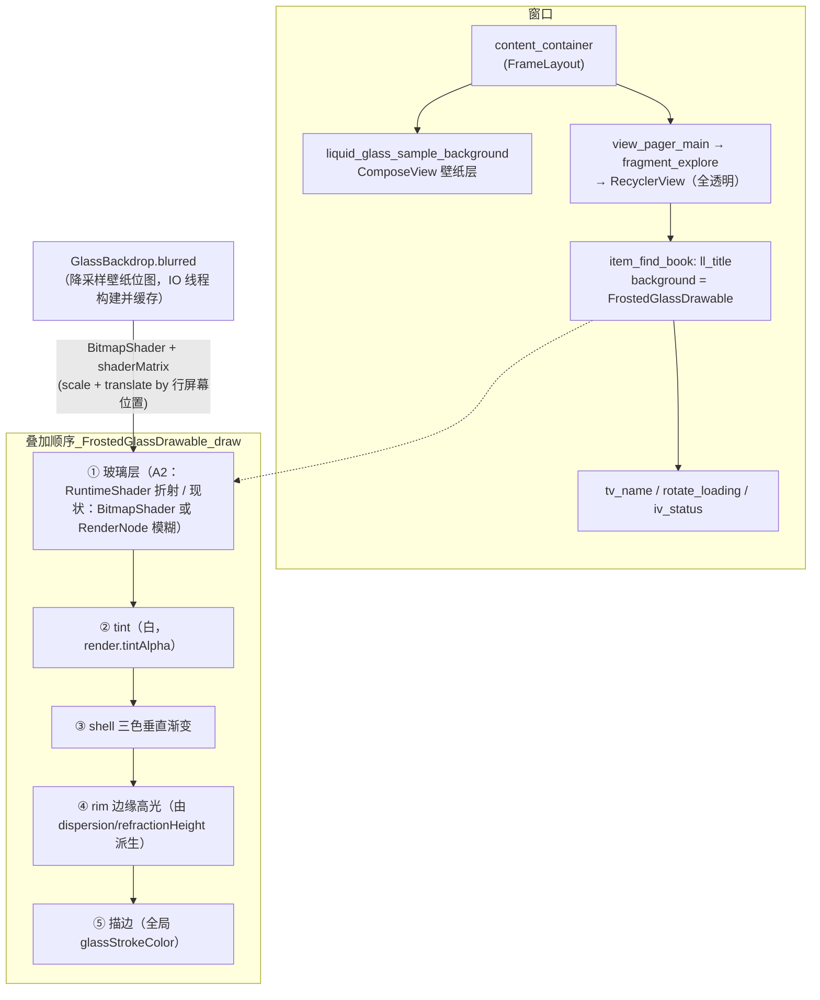
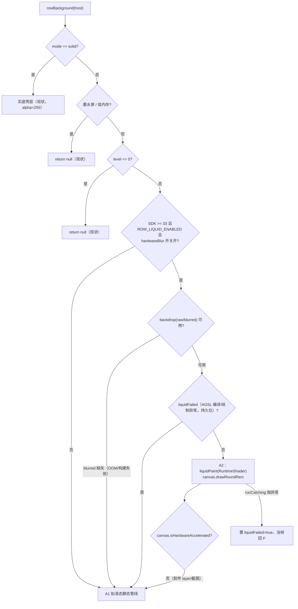
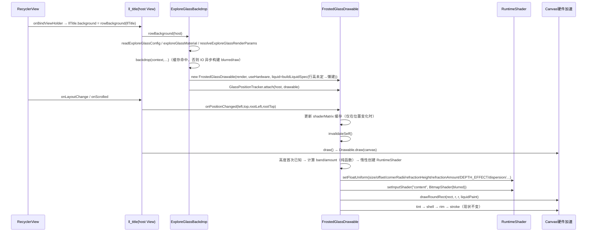
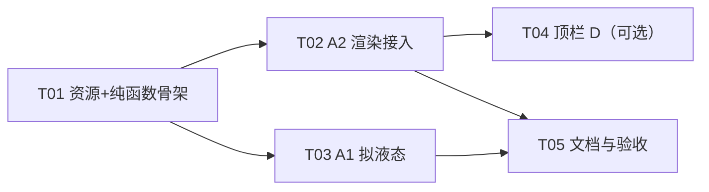

# 发现页行内「液态玻璃观感」技术方案论证（1.25.10 提案）

> 状态：**设计稿，待用户拍板**（本文不修改任何生产代码）
> 基线：`HEAD=0e44ffbf1`（1.25.9 回退版，工作区干净）
> 目标：让 `item_find_book.xml` 的 `ll_title`（书源名行）获得与底栏
> `StableLiquidGlassView`（`com.qmdeve.liquidglass:core:1.0.3`）一致的液态玻璃观感，
> 且**从原理上不可能复现 1.25.8 的 native 崩溃**、滚动性能可接受、API<33 有兜底。

---

## 0. 一页结论（先看这个）

| 结论 | 内容 |
|---|---|
| **推荐主方案** | **方案 A2「共享静态纹理 + 真 AGSL 折射」**：不引入任何「按采样源整树录制」的机制，把底栏那颗同一个 AGSL 着色器（MIT，AAR 内 `res/raw/liquidglass_effect.agsl`）**复制进 app 资源**，输入纹理换成**现有的降采样壁纸位图**（`GlassBackdrop.blurred`，仓库里早就有、IO 线程构建、按 key 缓存），用 `RuntimeShader` 当 Paint shader 直接画行背景。折射带、色散彩边、边光全部是真算出来的，**但没有一次 `RenderNode` 录制，也不碰第三方库的 `record()` 路径**。 |
| **为什么不是「真折射列表内容」** | 核实过：`ll_title` 背后**没有列表内容**（行与行不重叠，flexbox 书网格在 `ll_title` 下方），背后只有**主题壁纸层**（`activity_main.xml:13-19` 的 `liquid_glass_sample_background` ComposeView）。所以「行内真折射」折射的必然就是壁纸——而壁纸这张位图仓库里已经有现成的降采样版本，**根本不需要录制**。这是本轮最关键的结论：1.25.8 用录制的方式拿到的内容，和一张静态壁纸位图是同一个东西。 |
| **崩溃面** | A2 的代码路径里没有 `RenderNode.beginRecording/endRecording`、没有 `View.draw(canvas)` 重录、没有对第三方库的任何调用。1.25.8 的 abort 根因（`node` 录制中再次 `drawRenderNode(node)` → hwui 重入录制）在当前路径上**不存在对应的调用**，属结构性排除，而非"加了判断所以不会"。 |
| **观感达成度** | 底栏 6 个可感知视觉要素中，行内能还原 5 个（模糊/白色 tint/shell 三色渐变/描边/折射+色散边光），还原不了「实时透过玻璃看到滚动内容」——这一项在行内**物理上不存在可折射的对象**，任何方案都给不了。 |
| **代价** | API33+ 滚动时每帧 ~3.6M 次纹理取样（与底栏现有 2~3 个实例的 2.6~3.9M 同量级），静止帧 0 开销；API31-32 与 API≤30 维持现状（可选加方案 A1 的拟液态高光）。 |
| **兜底/回滚** | 编译期常量 + 运行期四级降级（API 判定 / `canvas.isHardwareAccelerated` / AGSL 编译失败 / 逐帧绘制异常），失败即**退回静态管线**（`ROW_PSEUDO_LIQUID_ENABLED` 保持默认 `true` 时仍叠 A1 拟液态层；两个总闸都置 `false` 才逐像素等于 1.25.9）；**不新增偏好键**，`git revert` 一个提交即可完全回到基线。 |
| **待拍板** | 见 §12（4 条：观感目标、行标定 vs 同参数、是否本轮带顶栏、开关形态）。 |

---

## 1. 事实核查（写方案前必须钉死的前提）

### 1.1 行背景到底「透」什么

```
activity_main.xml:8-28   content_container (FrameLayout)
                          ├─ ComposeView id=liquid_glass_sample_background  ← 主题壁纸层（ComposeThemeImageLayer）
                          └─ LockableViewPager id=view_pager_main            ← 发现页在这里面
                               └─ fragment_explore.xml: 根 ConstraintLayout（无 background）
                                    ├─ TitleBar（classic 模式下在列表上方，不重叠）
                                    └─ SwipeRefreshLayout → FrameLayout → fl_discover_books
                                         └─ RecyclerView rv_discover_books（无 background）
                                              └─ item_find_book.xml
                                                   ├─ LinearLayout id=ll_title  background=@drawable/bg_find_book_group
                                                   └─ FrameLayout > FlexboxLayout(flexbox)  ← 在 ll_title 下方，不重叠
```

- `bg_find_book_group.xml` = `<solid color="@color/transparent10"/>`（`#10000000` / 夜间 `#10ffffff`）+ `corners radius=@dimen/ui_panel_radius`(=10dp)。
- 行根 `background=@drawable/bg_item_focused_on_tv` 是**只有 focused 分支的 selector**，常态 = 透明。
- 结论：**`ll_title` 的 rect 里除了它自己的半透明底色，背后只有壁纸层**。没有其他行、没有滚动内容、没有卡片的其它部分。

> 这条事实直接决定了方案取舍：
> - 「真折射滚动内容」在行内**没有可折射对象**（方案 B 的核心动因此不成立）；
> - 真正被折射的是**壁纸**，而壁纸是静态位图，`ExploreGlassBackdrop` 已经把它降采样 + 软件模糊好放在 `GlassBackdrop`（`ExploreGlassBackdrop.kt:63-66`）里了。
>
> 所以「真折射」的正确实现是**共享静态纹理 + 位置采样**，而不是「共享实时快照」。

### 1.2 壁纸可能退化为纯色

`MainThemeBackgroundState.from()`（`MainThemeBackgroundLayer.kt`）在用户没设背景图时返回 `file=null`，
`buildBitmap()`（`ExploreGlassBackdrop.kt:867-940`）只 `drawColor(fallbackColor)` 铺一层纯色。
此时任何折射着色器都无高频内容可弯折 → **视觉增量≈0**（色散也退化为同色叠加）。
这不是缺陷，是必须向用户交代的前提（见 §12 决策 D1）。

### 1.3 现有静态管线：可插拔点已经存在

`FrostedGlassDrawable.draw()`（`ExploreGlassBackdrop.kt:1121-1189`）现在的玻璃层只有两条分支：

| 分支 | 条件 | 落点 | 代码 |
|---|---|---|---|
| 硬件（API31+）| `useHardware && raw != null` | `HardwareGlassLayer.draw()`：把「画一张 BitmapShader 矩形的绘制指令」录进**自己的一颗** `RenderNode`，对其 `setRenderEffect(blur)`，再 `canvas.drawRenderNode` | `ExploreGlassBackdrop.kt:1232-1326`，draw 分支 `1146-1160` |
| 软件（API21+/降级）| 其余 | `canvas.drawRoundRect(rect, r, r, glassPaint /* BitmapShader(blurred) */)` | `1161-1171` |

之后固定三层叠加（与底栏同口径）：tint（白）→ shell 三色渐变 → rim 边光 → 描边（`1174-1188`）。
**A2 的改动点就是这两条分支里的「玻璃层」这一笔**，tint/shell/rim/描边一行不动。这是最小爆炸半径。

### 1.4 第三方库机制（反编译复核，与 1.25.9 结论一致）

`core-1.0.3.aar` 内容：`classes.jar` + **`res/raw/liquidglass_effect.agsl`** + `R.txt`。反编译 `LiquidGlassimpl`：

```
record():      node.beginRecording(target.getWidth(), target.getHeight())
               canvas.translate(targetLoc - hostLoc)
               target.draw(canvas)            ← 采样源整棵子树被重绘进 node
               node.endRecording()
applyRenderEffect():
               RuntimeShader.setFloatUniform(...)  // size/offset/cornerRadii/refractionHeight/
                                                   // refractionAmount/depthEffect/chromaticAberration/
                                                   // contrast/whitePoint/chromaMultiplier/tintColor/tintAlpha
               eff = RenderEffect.createRuntimeShaderEffect(liquidShader, "content")   // since API 33
               eff = RenderEffect.createChainEffect(eff, blurEffect)                    // 先模糊再着色
               node.setRenderEffect(eff)
draw(canvas):  canvas.drawRenderNode(node)      // 非硬件加速 Canvas 直接 return
```

- `content` 这个 `uniform shader` **由 RenderEffect 绑定为 node 的录制内容**，库没有任何 API 允许外部替换纹理
  （`LiquidGlass` 公开面只有 `init(ViewGroup)` / `updateParameters()` / `onDraw`；`widget.LiquidGlassView` 只有 `bind(ViewGroup)` 与 setters）。
- `Config` 默认 `DEPTH_EFFECT=0.3`、`ECCENTRIC_FACTOR=1.0`；`StableLiquidGlassView.overrides()`
  （`StableLiquidGlassView.kt:274-294`）用 `noFilter()/contrast(0)/whitePoint(0)/chromaMultiplier(1)`，
  即底栏实际生效的是 `depthEffect=0.3`、`chromaticAberration=material.dispersion`、
  `refractionAmount=-refractionOffsetPx`（**负值 = 向内位移**）。
- 1.25.8 崩溃根因（采样源是祖先 → `target.draw()` 把玻璃自己再画一遍 → node 重入录制 → hwui abort）
  已经在 `LiquidGlassSourceGuard.selfOrAncestorContains` 上落地为纯函数守卫。

### 1.5 AGSL 着色器是可复用资产（关键）

`res/raw/liquidglass_effect.agsl`（MIT License，`Copyright (c) 2025 QmDeve`）是**纯函数式**的：

```glsl
uniform shader content;  uniform float2 size; uniform float2 offset; uniform float4 cornerRadii;
uniform float refractionHeight, refractionAmount, depthEffect, chromaticAberration;
uniform float contrast, whitePoint, chromaMultiplier; uniform float3 tintColor; uniform float tintAlpha;
half4 main(float2 coord) {
  // sd = 到圆角矩形内边界的有符号距离
  // -sd >= refractionHeight → 中心区：单次 content.eval(coord) + 色调映射 + tint
  // 其余（边缘带）→ circleMap 位移 + 沿 SDF 梯度方向 7 taps（RGB 各向 ±1/3、±2/3 位移）= 色散
}
```

已核对 7 taps 权重：`R: 1/3.5×3 + 1/7`、`G: 1/3.5×3 + 1/7`、`B: 1/3×3`、`alpha: 7×1/7=1`
→ 能量守恒，`chromaticAberration=0` 时 7 个样本相同 → 输出严格等于 `content`。
**这意味着我们可以安全地「只开色散 vs 全参数」地做灰度降级**，不会突然变亮变暗。

---

## 2. 方案空间与逐条论证

统一评价口径：**观感达成度**对照底栏 6 个可感知要素
①实时高斯模糊 ②白色 tint ③shell 三色渐变 ④描边 ⑤边缘折射带（体积感） ⑥色散彩边。

### 方案 A：静态管线视觉升级（拟液态，无 shader）

- **原理**：不动采样模型。在 `FrostedGlassDrawable` 现有 rim 层基础上补：圆角内侧顶部高光带（现状只有
  `rimShader` 的上下渐变）、边缘三色微偏移（伪色散：R/G/B 三层 1px 错位描边）、内阴影（底部暗线）
  制造厚度感；可选在已模糊位图上做**方向性位移采样**（`BitmapShader` 局部矩阵 + 分层 2-3 次错位绘制）模拟折射错位。
- **可行性证据**：rim/shell 已经是 `LinearGradient`（`:1072-1119`），追加层次是纯 Drawable 改动；
  `Paint` + `BitmapShader` 的错位绘制在软件/硬件 Canvas 上都成立（API 21+）。零新 API。
- **观感达成度**：①②③④ 已有；⑤ 只能"渐变近似"，没有真正的位图弯折；⑥ 用手绘色边近似 → **5 项全有但 ⑤⑥ 是赝品**。
  底色是纯色时也不塌（这是它唯一的优势）。
- **性能**：每行多 2-3 次 RRect 绘制（~10 万 px 级填充），相对现状 +1~2% GPU。
- **风险**：极低（纯 `Paint`/`GradientDrawable`）。
- **工作量**：0.5 人日（含单测）。
- **API<33 兜底**：本身就是兜底方案。

### 方案 A2：共享静态纹理 + 真 AGSL 折射（**推荐**）

- **原理**：把 AAR 里那颗 AGSL（MIT）复制为 `app/src/main/res/raw/glass_row_liquid.agsl`，在行渲染器里
  `RuntimeShader` 当 **Paint shader** 使用：`setInputShader("content", BitmapShader(GlassBackdrop.blurred))`，
  局部矩阵把「行局部像素坐标」映射到「屏幕对齐的降采样壁纸」；uniform 里
  `size=(行宽,行高)`、`offset=(0,0)`、`cornerRadii=radius`、`refractionHeight/refractionAmount/chromaticAberration`
  取该档预设（经行高标定）、`contrast=0/whitePoint=0/chromaMultiplier=1/tintAlpha=0`（tint 仍由既有 tintPaint 负责，避免双重着色）。
  然后 `canvas.drawRoundRect(rect, r, r, liquidPaint)` —— 与现有软件分支同一笔，只换 Paint。
- **可行性证据**：
  - `RuntimeShader` **since API 33**（`platforms/android-36/data/api-versions.xml` 核实）；
    `setInputShader(String, Shader)`、`setFloatUniform` 全在公开 API 面（`javap android.graphics.RuntimeShader` 已核对）。
  - 同一颗 shader 在库里的用法是 `RenderEffect.createRuntimeShaderEffect(shader,"content")`（since 33），
    证明 AGSL 源码本身在目标设备上可编译通过（底栏天天在跑）。
  - 内容源（降采样壁纸）已有：`GlassBackdrop.blurred`，构建在 IO 线程且按 key 缓存（`:791-853`），
    **不需要新增任何位图、不需要录制**。
  - 坐标对齐链路已存在且被验证：`shaderMatrix` = `scale(bw/rootW, bh/rootH)` + `translate(-(loc-root)*scale)`（`:1136-1144`）。
  - ⚠️ **未验证**：`RuntimeShader` 作为 **Paint shader**（而非 RenderEffect）在硬件 Canvas 上的行为。
    这是唯一的技术不确定性，验证成本极低（见 §7 POC 清单），失败则退 **A2'**。
- **A2'（等价兜底形态）**：若 paint-shader 形态不可用，则用**现有 `HardwareGlassLayer` 同款**做法：
  自建一颗 `RenderNode`，内容 = 把壁纸位图按行位置画进一张 `行尺寸 + 2×pad` 的矩形，然后
  `setRenderEffect(createChainEffect(createRuntimeShaderEffect(shader,"content"), blur?))`，
  `canvas.drawRenderNode`。仍然是「我们自己画的矩形」被录制，**不是视图树录制**，
  所以录制代价是 1 条 `drawRect`（纳秒级）且**结构上不可能重入**。
- **观感达成度**：①②③④⑤⑥ **全中**，且 ⑤⑥ 与底栏**同一份数学**（同一 SDF、同一 circleMap、同一 7-taps 色散、
  同一 `depthEffect=0.3`）。唯一差异：底栏折射的是「滚动内容+壁纸」，行内折射的是「壁纸」——观感仍是「移动的透镜」
  （透镜（行）在壁纸上移动），但**不会有文字/封面的实时弯折**。
- **性能**：见 §6。量级 = 底栏现有 3 实例之和的 ~0.9×；静止帧 0。
- **风险**：
  1. paint-shader 形态未验证（→ A2'）；
  2. **每行一个 `RuntimeShader` 实例**（屏幕上约 6~10 个 `ll_title`）：`new RuntimeShader(src)` 会做 AGSL 编译，
     Skia 侧是否有按源码 hash 的缓存**未验证** → 首次绑定/首次滚动可能有一次 spike。缓解：进程内预热一个实例；
     若实测有 jank 则退「实例池 + 只在可见行数 ≤ N 时启用」。
  3. 行高只有 ~32-40dp，预设 `refractionHeightDp=22~34dp` **大于半行高** → 若不标定，整行都落进折射带
     （7 taps 铺满整行 + 视觉上整体被"糊"）。**必须做行高标定**（§5.2）。
  4. 位图位移穿帮：`BitmapShader` 用 `CLAMP`，位移到屏幕外会重复边缘像素 → 边缘可能出现轻微拖影（底栏同样问题，可接受）。
- **工作量**：2.5 人日（shader 资源复制与裁剪 0.3d + 纯函数与单测 0.7d + 渲染/降级接入 1.0d + 真机标定 0.5d）。
- **API<33 兜底**：走方案 A（拟液态）或原静态管线，见 §5.3 决策树。

### 方案 B：共享「实时列表」快照折射

- **原理**：每 N 帧把列表区域（`content_container` 或 `fl_discover_books`）录制/抓取成一张降采样位图，
  所有行共用这张纹理 + 各自位置偏移采样；录制期间需把玻璃自身 `INVISIBLE` 或用双缓冲 node 避免自引用。
- **可行性证据 / 致命点**：
  1. **动机不成立**：§1.1 已证明 `ll_title` 背后没有列表内容。即便把整屏列表拍下来，`ll_title` 位置上采到的
     仍然只是壁纸。想要"折射邻居行"就得让玻璃反向采样一个它**不可能看见**的区域 —— 属于伪造，等价于方案 A2 换纹理。
  2. 真正的"实时快照"手段只有 `PixelCopy`（需要 `Window`/`Surface`，**每帧 GPU→CPU 回读**，1080p 一次 ~8MB 拷贝，
     60fps = 480MB/s，直接不可接受）或 `RenderNode` 录制（= 1.25.8 的做法，崩溃面）。
  3. 若改为"每 N 帧"录制，会引入玻璃纹理与内容的时间错位（滚动时行内玻璃比文字慢 1-3 帧，
     观感是"糊了一层贴纸"），底栏之所以没有这个问题是因为它每帧都录。
- **结论**：**否决**。成本最高、风险最高、而这个场景下收益为 0。
- （例外：如果将来要做"悬浮在列表上的搜索条/FAB"，领域才回到 B —— 那时直接用方案 D 的库原路径即可。）

### 方案 C：整条单层玻璃 + 透明挖孔

- **原理**：把玻璃层提到 RecyclerView **之下**（或之上）的一层，用一个整屏 Drawable 按当前可见行的 rect 列表
  画 N 个圆角矩形，"行标题位置"只是透明挖孔，玻璃由一层统一渲染。
- **可行性证据**：技术上可行（`onDraw`/`dispatchDraw` + `Path` 并集，行 rect 由 `RecyclerView` 的 `LayoutManager`
  实时给出）。但：
  1. 放在 RecyclerView **之上** → 覆盖文字与点击区（需要再挖一次孔给文字，等于没省）；
     放在**之下** → 需要 RecyclerView 与 item 全透明（现状确实透明），但玻璃层会同时透出**行内容区域**
     （flexbox 书网格之间的空隙），出现「玻璃在书封面后面」的错误层次。
  2. 行 rect 每帧随滚动变化 → 仍然要每帧重画 N 个 RRect，**开销与 A2 完全相同**（shader 每像素成本一样）。
  3. 引入"挖孔 mask 与 item 布局不同步"的新一类 bug（字体缩放、展开动画、sticky header）。
- **结论**：**否决** —— 与 A2 同成本，复杂度高一个量级，无收益。

### 方案 D：只在非行内位置启用液态（顶栏 / 悬浮控件）

- **原理**：`MainTopBarView.setBackdropBlur(source)` 已具备完整能力（`MainTopBarView.kt:272-302`，
  `supportsBackdropBlur()` = API≥33，参数走 `topBarGlassSpec` = 同一份 `GlassMaterialPreset`），
  但两个宿主都传 `null`（`ExploreFragment.kt:1931`、`bookshelf/style1/BookshelfFragment1.kt:198`）
  → 玻璃层恒 `GONE`，**从未激活**。
- **关键坑（本轮核查新发现）**：**不能**像底栏那样传 `content_container` —— 顶栏在
  `content_container → view_pager_main → fragment_explore` 之内，`content_container` 是它的**祖先**，
  正是 1.25.8 那类崩溃的采样源。合法源只能是**兄弟子树**：`swipe_refresh_layout`（或 `fl_discover_books`）。
- **适用性**：只有 modern 发现页（`composeDiscoverTopPadding` 让内容滚到顶栏下方，
  `ExploreFragment.kt:1904-1932 updateModernTopBarOverlay()`）才"背后有内容"；
  classic 模式顶栏在列表上方，玻璃后面什么都没有（等于白开）。
- **观感达成度**：modern 模式下 ①②③④⑤⑥ 全中，且是**真实的滚动内容折射**（最有说服力的"液态"演示）。
- **性能**：+1 次「按采样源整树录制/帧」（`swipe_refresh_layout` 子树）。注意：**底栏现在最多有 3 个实例
  都在绑 `content_container`**（`MainActivity.kt:1683/1696/1709` → `:2048 bind(contentContainer)`；
  standard 布局模式下 `1696` 分支不执行，即 2 个），也就是现有 App 每帧已经做 2~3 次全屏子树录制。
  再加 1 个是同量级，但**这个成本模型本身是可疑的**（§9 列为观察项：可优化为单实例 + 共享快照，非本轮范围）。
- **风险**：中（依赖库的每帧录制；但采样源是兄弟 → 无重入风险）。
- **工作量**：1 人日（源合法性纯函数 + 两处宿主接线 + class 模式关闭）。
- **API<33 兜底**：`supportsBackdropBlur()` 已返回 false → 现有非覆盖布局兜底，无需新增逻辑。

### 方案 E：复用库 + 自控采样（task 指定的「必须评估」项）

**问题**：能否复用 AAR 内的 `RuntimeShader`/AGSL 资源，自己控制纹理来源？

| 复用什么 | 可行性 | 结论 |
|---|---|---|
| `com.qmdeve.liquidglass.LiquidGlass` / `widget.LiquidGlassView` 的**公开 API** | 公开面只有 `bind(ViewGroup)` / `init(ViewGroup)` + setters，**没有注入纹理的入口**；`content` 由 `RenderEffect` 绑定到 node 的录制内容 | ❌ 不可行 |
| 反射改私有字段 `LiquidGlassimpl.liquidShader` | 能拿到 shader 对象，但 `content` 仍绑定在 node 录制内容上（`applyRenderEffect` 里写死 `createRuntimeShaderEffect(shader,"content")` 且 `node` 由 `record()` 填充），拿不到纹理替换点 | ❌ 不可行 |
| **AAR 内的 AGSL 源码**（`res/raw/liquidglass_effect.agsl`） | 纯文本、MIT 许可、无隐藏依赖；复制进 app `res/raw/` 后由我们自己的 30 行宿主驱动 | ✅ **可行 → 这就是方案 A2** |
| AAR 内的 `R.raw.liquidglass_effect` 直接引用 | 仓库开启 `android.nonTransitiveRClass=true`（`gradle.properties:42`），跨模块 R 引用不确定；且库升级可能改名/改 shader | ⚠️ 不推荐（**未验证**，且耦合内部实现） |

**结论**：**"复用 shader + 自控采样" = 方案 A2**。这是唯一既能拿到"底栏同款数学"、又不继承"每帧整树录制"的形态。
库的 Java 宿主部分（`LiquidGlass`/`LiquidGlassView`）没有任何可复用价值 —— 它的全部价值就是那颗 shader。

---

## 3. 方案对比总表

| 维度 | A 拟液态 | **A2 真折射（荐）** | B 实时快照 | C 单层挖孔 | D 顶栏液态 | E 复用库宿主 |
|---|---|---|---|---|---|---|
| 观感要素 ①~④ | ✅ | ✅ | ✅ | ✅ | ✅ | ✅ |
| ⑤ 折射带 | 近似 | **真** | 真 | 真 | **真** | 真 |
| ⑥ 色散彩边 | 近似 | **真** | 真 | 真 | **真** | 真 |
| 崩溃面 | 无 | **无（无录制）** | 高（录制） | 无 | 中（兄弟源录制，已验证类用法） | **高（就是 1.25.8）** |
| 滚动每帧新增成本 | ~1% | ~90% 底栏量级 | 灾难级 | ~90% 底栏量级 | ~100% 底栏单实例 | 灾难级（N×全屏录制）|
| 额外内存 | 0 | 0（复用现有位图） | +2 张全屏位图 | 0 | +1 张全屏 node 纹理 | +N 张全屏 node |
| 纯色底主题是否有感 | 有 | **无**（需壁纸） | 无 | 无 | modern 模式有 | — |
| 工作量 | 0.5d | 2.5d | 6d+ | 4d | 1d | 不可行 |
| 建议 | API<33 及首版兜底 | **主方案** | 否决 | 否决 | 可选并行（T04） | 否决 |

---

## 4. 推荐方案与演进路径

**推荐组合（分两阶段，可独立交付、可独立回滚）**

- **阶段 1（必做）**：行内 **A2**（API33+ 真折射）+ **A1**（API<33 拟液态高光，同时作为 A2 的视觉底座）。
- **阶段 2（可选，独立开关）**：顶栏 **D**（`MainTopBarView.setBackdropBlur(swipeRefreshLayout)`，仅 modern 布局），
  用最少的代码把「液态」放到用户每天都能看到的固定位置。

**为什么不"一步到位"**：
A2 的观感上限受「背后是静态壁纸」约束（纯色底主题下增量≈0）。所以先交付 A2（成本 2.5d，随时可回滚），
真机确认有效再决定要不要追加 D。**若用户仍不满意，升级路径是"把 A2 的内容源从壁纸换成实时快照"= 方案 B**，
而 A2 已经把「AGSL + 位置采样 + 降级矩阵」全部铺好，B 只需要替换 `content` 的来源（届时再评估 PixelCopy/录制的代价）。

**若 A2 的 POC 失败**（`RuntimeShader` 不能当 Paint shader）：
→ A2'（自建小 RenderNode + `createChainEffect`，仓库已有同款用法）；观感一致，成本 +0.5d。
→ 若连 A2' 也不可用：只剩 A1（拟液态），并向用户说明"真折射在行内受架构限制"。

---

## 5. 关键算法与设计细节

### 5.1 渲染层级（现状 vs A2）



### 5.2 行高标定（必须做，且必须放进纯函数）

底栏是 56dp 高的 pill，预设 `refractionHeightDp=22~34dp` ≈ 半高，`refractionOffsetDp=42~66dp`。
行高只有 ~32-40dp，直接套用会让**整行**都落在折射带内（`-sd < refractionHeight` 恒成立），
表现为整行被 7-taps 拉花 + 满负荷取样。

引入两个行标定纯函数（新增，**不改 `GlassMaterialPreset` 公式**，与现有 `ROW_*_GAIN` 同一位置同一风格）：

```
// 折射带宽：不得吃掉整行，按像素高度限幅 42%（与 StableLiquidGlassView.effectiveRefractionHeight
// 的 pixelSafePill 口径 0.42 一致，见 StableLiquidGlassView.kt:301-307）
fun rowRefractionBandPx(heightPx: Float, presetBandDp: Float, density: Float): Float =
    min(presetBandDp * density, heightPx * 0.42f).coerceAtLeast(1f)

// 位移量：不得超过带宽的 1.6 倍，否则内采样会跨过整行、退化成"平均色涂抹"
fun rowRefractionAmountPx(bandPx: Float, presetOffsetDp: Float, density: Float): Float =
    min(presetOffsetDp * density, bandPx * 1.6f).coerceAtLeast(0f)
```

除数值外，`cornerRadii` 必须**分别**传给 shader（`radiusAt` 用 `centeredCoord` 的符号选角，四值相等即可）。

### 5.3 降级决策树（四级，全部延续现有风格）



### 5.4 调用时序（A2）



### 5.5 代码落点（改动清单，供工程师对照）

| 文件 | 改动 | 规模 |
|---|---|---|
| `app/src/main/res/raw/glass_row_liquid.agsl`（新） | 复制 AAR 的 AGSL + 保留 MIT 版权头 + 加一行说明 | ~130 行 |
| `ui/main/explore/RowGlassLiquidSpec.kt`（新） | 纯函数：band/amount/uniform 数据类/可用性三态判定 | ~120 行 |
| `ui/main/explore/RowGlassLiquidRenderer.kt`（新） | `@RequiresApi(33)`：加载 AGSL、持有 `RuntimeShader`、`liquidFailed` 持久位、A2' 兜底形态 | ~150 行 |
| `ui/main/explore/ExploreGlassBackdrop.kt` | `FrostedGlassDrawable` 增加 `liquidPaint` 分支（替换 `1161-1171` 那一笔）+ `rowBackground` 里注入 spec | ~60 行改动 |
| `ui/main/explore/RowRimSpectrum.kt`（新，T03） | A1 的拟液态纯函数（顶部高光带 alpha、三色描边偏移量） | ~60 行 |
| 单测 3 个文件 | 见 §8 | ~250 行 |

---

## 6. 性能模型

### 6.1 静态估算（1080×2400 / density 2.75 / 60fps）

| 项 | 计算 | 结果 |
|---|---|---|
| 行高 | padding 6+6dp + 文本行 ~20-24dp | ≈ **32~36dp = 88~99px** |
| 行宽 | 1080 − root padding 16dp×2 | ≈ **992px** |
| 折射带 | `min(preset 22~34dp, 0.42×行高)` = 0.42×36dp | **15.1dp = 41.6px** |
| 带宽内像素 | 2 × 992 × 41.6（忽略圆角） | **82.5k px** |
| 带宽内取样 | 7 taps | **578k texel/行** |
| 中心区 | 992×99 − 82.5k ≈ 15.7k px × 1 tap | 16k texel/行 |
| **单行合计** | | **≈ 0.59M texel** |
| 可见行数 | 每 item = 标题行 + 书网格，屏幕约 4-6 个 item | **≈ 6 行** |
| **滚动每帧** | 6 × 0.59M | **≈ 3.6M texel/frame → 214M texel/s** |
| 底栏基线（2~3 实例，pill 56dp，band 34dp；standard 布局下 2 个） | 每实例 1.3M × 2~3 | **≈ 2.6~3.9M texel/frame** |
| **相对增量** | 3.6 / 3.9 | **≈ 0.9× 现有底栏开销** |
| 额外填充率 | 每行多一层 992×99 全行 quad | +0.59M px/frame（可忽略） |
| 位图/纹理上传 | **0**（复用已存在的 `blurred` 位图，无新增 Bitmap、无每帧 upload） | 0 |
| 静止帧 | RecyclerView 不 invalidate → Drawable 不重绘 | **0** |

**结论**：滚动期 GPU 增量与「底栏现有玻璃」同量级，属于同一 budget 内；**没有** 1.25.8 那种
「每帧 N 次全屏子树录制 + N 张全屏 node」的灾难项。

### 6.2 真实风险的量级（比 fillrate 更需要盯）

1. `RuntimeShader` 实例数与 AGSL 编译：10~15 个可见行 → 每次 `bind` 新建一个实例。**未验证** Skia 是否按源码
   hash 缓存编译结果。→ 用 `dumpsys gfxinfo` 看「首次滚动」vs「二次滚动」的帧耗时差。
2. 每行多一层 RRect 的 overdraw（含圆角 clip）→ `adb shell dumpsys gfxinfo <pkg> framestats` 对比。
3. AGSL 内部 7-taps 是**依赖纹理读取**（位移取决于 coord），移动 GPU 上带 2-3 倍惩罚 —— 上表已按 texel 数保守估计。

### 6.3 真机验证方法（可直接照做）

```bash
# 0) 基线：先跑 1.25.9（未改动）采一组
adb shell dumpsys gfxinfo io.legado.app reset
# 反复上下滚动发现页 10 秒（固定手势/固定停留位置，最好用 scrcpy 宏或 --slow 脚本）
adb shell dumpsys gfxinfo io.legado.app | sed -n '1,40p'     # 看 帧耗时分位 / Janky frames / 95th pct
adb shell dumpsys gfxinfo io.legado.app framestats > base.txt

# 1) 改后同样操作，取 after.txt，对比：
#    - Total frames / Janky frames(%)
#    - 50th/90th/95th/99th percentile
#    - GPU 各阶段（framestats 里 DrawFrame 各段）

# 2) GPU 渲染条形图（Android Studio Profiler > GPU，或）：
adb shell dumpsys SurfaceFlinger --latency <layer>       # 需要 layer 名
# 或开启开发者选项「GPU 渲染模式分析 → 在屏幕上显示为条形图」

# 3) 特效开关 A/B：临时把 ROW_LIQUID_ENABLED 置 false 再采一组，
#    确认增量确实来自本方案而不是噪声（同一台设备、同一滚动手势，3 次取中位数）

# 4) 崩溃/降级日志（本方案必须做到"失败也无声降级"）：
adb logcat -s ExploreGlass:* AndroidRuntime:E DEBUG:* | grep -i "agsl\|RuntimeShader\|liquid"
```

**验收阈值（建议）**：scroll janky% 增幅 ≤ 1.5 个百分点；95th 帧耗时增幅 ≤ 1.5ms；无新增 crash/ANR 上报。

---

## 7. POC 验证清单（不改生产代码，一次性文件，验完删除）

| # | 要验证的假设 | 最小验证方式 | 失败后果 |
|---|---|---|---|
| P1 | `RuntimeShader` 可作 **Paint shader** 在硬件 Canvas 上生效（行局部坐标 + `setInputShader` 输入 BitmapShader） | 一个临时 `Activity`（`app/src/main/java/.../tmp/PocLiquidActivity.kt`，仅 debug 手点进入）+ 20 行绘制；`git status` 后删除 | 退 A2' |
| P2 | 同一 AGSL 在 `size=(992,99)`、`refractionHeight=41.6`、`refractionAmount=-60` 下视觉正常（无撕裂/无明显重复边缘） | 同上，截图对比 | 调 band/amount 标定 |
| P3 | 多实例（15 个）的 AGSL 编译开销 | 在 P1 里循环创建 30 个实例并打点 `System.nanoTime()` | 加实例池/预热 |
| P4 | 软件 Canvas 上的行为（截图/软件 layer） | P1 里对 `Canvas(bitmap)` 也画一次 | 已在 §5.3 用 `isHardwareAccelerated` 短路 |

> 以上 4 条都只影响"要不要退 A2'"，不影响架构选择 —— 因为 A2 / A2' / A1 三者共享同一套
> `RowGlassLiquidSpec` 纯函数与同一套降级矩阵。

---

## 8. 测试策略

### 8.1 可纯 JVM 单测（必须覆盖）

| 被测纯函数 | 断言要点 |
|---|---|
| `rowRefractionBandPx(heightPx, presetDp, density)` | 行高 99px 时 = 41.6（0.42 限幅生效）；pill 高度 154px 时不限幅；永不为 0/负数 |
| `rowRefractionAmountPx(bandPx, presetDp, density)` | 不超过 `1.6×band`；预设负值时归一 |
| `rowLiquidUniforms(spec)` → data class | 与底栏逐值对齐：`depthEffect=0.3`、`contrast=0`、`whitePoint=0`、`chromaMultiplier=1`、`tintAlpha=0`（tint 由 tintPaint 负责）、`chromaticAberration=material.dispersion` |
| `rowSampleMatrix(bitmapW, bitmapH, rootW, rootH, locX, locY, rootX, rootY)` | 与 `ExploreGlassBackdrop.kt:1136-1144` 结果逐值一致（把内联逻辑提取成纯函数后才能断言） |
| `rowLiquidCapability(sdkInt, hardwareBlurPref, isEInk, isLowRam, canvasHardware, liquidFailed)` | 返回 `AGSL / RENDER_NODE / STATIC` 三态；API32 → 非 AGSL；`liquidFailed=true` → STATIC |
| `rowRimSpectrum(...)`（A1） | 顶部带 alpha 随 dispersion 单调；三色偏移量 ≤ 1px；档位差异可见（glass 档 > frosted 档） |
| 既有：`EXPLORE_GLASS_PREF_KEYS` 反向断言 | **不新增偏好键**，故 `ExploreGlassHardwareBlurTest` 预期集合不变（这是本方案"零迁移负担"的证明） |

### 8.2 必跑命令

```bash
./gradlew :app:testDebugUnitTest --tests '*Glass*' --tests '*RowGlass*'
python3 tools/check_settings_mapping.py          # 本方案不动设置页，应零告警（回归门）
./gradlew :app:assembleDebug                     # lint: @RequiresApi 标注齐全（API33/RenderEffect 31）
```

> `@RequiresApi(33)` / `Build.VERSION.SDK_INT` 守卫必须让 lint 的 `NewApi` 通过；
> 禁止用 `@SuppressLint("NewApi")` 绕（仓库现有风格是显式版本判定，见 `ExploreGlassBackdrop.kt:73-74`）。

---

## 9. 回滚与风险控制

| 层级 | 手段 | 效果 |
|---|---|---|
| L0 编译期 | `internal const val ROW_LIQUID_ENABLED = true`（`RowGlassLiquidSpec.kt` 单点） | 改 false = **全设备纯 A1**（A2 关闭、A1 保留）；要逐像素回到 1.25.9 需 `ROW_LIQUID_ENABLED` 与 `ROW_PSEUDO_LIQUID_ENABLED` **两个总闸都置 false** |
| L1 运行期（自动） | §5.3 决策树：SDK<33 / 无硬件加速 / AGSL 编译失败 / 绘制异常 | 逐行无声降级到静态管线，**不会出现空白行或未模糊透出** |
| L2 运行期（用户） | 复用现有 `exploreGlassHardwareBlur` 开关（「全局毛玻璃效果」页 → 硬件模糊） | 关掉即走纯软件管线（A1/现状），无需新增设置项 |
| L3 版本 | 单/双提交，`git revert` 即回到 `0e44ffbf1` | 无数据迁移、无偏好键、无布局 xml 变更（`item_find_book.xml` 不改） |
| 观察项 | 现底栏 2~3 个实例每帧各录制一次 `content_container`（`MainActivity.kt:1683/1696/1709` → `:2048`） | 非本轮范围，但若后续要加方案 D 的顶栏实例，建议先做"单实例 + 共享快照"再叠加，避免录制次数线性增长 |

---

## 10. 任务分解（有序、含依赖、可直接派给工程师）

> 约束：≤5 个任务；每个任务 ≥3 个文件；T01 为基础设施；后续尽量只依赖 T01/T02。

### T01 ｜ 着色器资源 + 行液态纯函数骨架（P0）
- **文件**
  - `app/src/main/res/raw/glass_row_liquid.agsl`（新，复制 MIT AGSL + 版权头 + 本仓库注释）
  - `ui/main/explore/RowGlassLiquidSpec.kt`（新：`RowLiquidRole`、`RowGlassLiquidUniforms`、
    `rowRefractionBandPx`、`rowRefractionAmountPx`、`rowLiquidCapability`、`rowSampleMatrix`、`ROW_LIQUID_ENABLED`）
  - `app/src/test/java/io/legado/app/ui/main/explore/RowGlassLiquidSpecTest.kt`（新）
  - `docs/third-party/AndroidLiquidGlassView-MIT.md`（新：MIT 全文 + 上游 URL + 我们复制了哪个文件的说明）
- **依赖**：无
- **验收**：① 单测全绿且能证明"A2 uniform 与底栏逐值对齐"；② AGSL 文件带完整 MIT 头；
  ③ `RowGlassLiquidSpec.kt` 不 import 任何 Android 类（纯 JVM 可测）。

### T02 ｜ 行渲染接入 A2（真折射）+ 四级降级（P0）
- **文件**
  - `ui/main/explore/RowGlassLiquidRenderer.kt`（新：`@RequiresApi(33)` 加载 AGSL、持有 `RuntimeShader`、
    `liquidFailed` 持久位、A2' 的 RenderNode 兜底形态）
  - `ui/main/explore/ExploreGlassBackdrop.kt`（改：`FrostedGlassDrawable` 加 `liquidPaint` 分支，替换 `1161-1171` 那一笔；
    `rowBackground()` 把 spec 传进去；kdoc 补"行内禁止 StableLiquidGlassView"的最新表述）
  - `app/src/test/java/io/legado/app/ui/main/explore/RowGlassLiquidDrawDecisionTest.kt`（新：降级矩阵三态覆盖）
- **依赖**：T01
- **验收**：① API33+ 真机行背景出现折射带 + 色散彩边（对比截图）；
  ② 只关 `ROW_LIQUID_ENABLED` = 全设备纯 A1（A2 关闭、A1 保留）；要「逐像素等于 1.25.9」
  须把 `ROW_PSEUDO_LIQUID_ENABLED` 也置 `false`（两闸全关后同一帧截图 diff 为空）；
  ③ API≤32 模拟器无异常、走静态管线；④ 无新增 `RenderNode.beginRecording(View)` 调用（`grep` 自证）；
  ⑤ `dumpsys gfxinfo` 滚动 jank 增幅 ≤1.5pp。

### T03 ｜ API<33 拟液态视觉升级 A1（P1）
- **文件**
  - `ui/main/explore/RowRimSpectrum.kt`（新：顶部高光带 alpha、三色描边偏移、内阴影强度，纯函数）
  - `ui/main/explore/ExploreGlassBackdrop.kt`（改：`rimShader`/描边层按 `RowRimSpectrum` 输出叠加）
  - `app/src/test/java/io/legado/app/ui/main/explore/RowRimSpectrumTest.kt`（新）
- **依赖**：T01（共享 uniform 口径）；与 T02 可并行
- **验收**：① API30 模拟器上行背景可见"顶部亮带 + 底部暗线 + 细微彩边"；
  ② 三档（solid/glass/frosted）差异肉眼可分且在浅色/深色主题下都不过曝；
  ③ 既有 `ROW_*` 常量与 `GlassMaterialPreset` 公式零改动。

### T04 ｜（可选）顶栏液态接入 D（P2，可整体丢弃）
- **文件**
  - `ui/widget/MainTopBarView.kt`（改：`setBackdropBlur` 增加"采样源兄弟合法性"校验复用 `LiquidGlassSourceGuard`）
  - `ui/main/explore/ExploreFragment.kt`（改：modern 布局下传 `binding.swipeRefreshLayout`，classic 传 null）
  - `app/src/test/java/io/legado/app/ui/widget/TopBarLiquidSourceTest.kt`（新：祖先源必须被拒）
- **依赖**：T02（复用同一 spec/降级口径）
- **验收**：① 只有 `layoutMode != 2` 且 API33+ 时玻璃层 VISIBLE；② 传 `content_container` 会被守卫拒绝（单测）；
  ③ 列表滚动时顶栏出现真折射；④ 可单独 revert 本任务而不影响 T02。

### T05 ｜ 验收记录与文档定稿（P0）
- **文件**
  - `CHANGELOG.md`、`app/src/main/assets/updateLog.md`、`docs/changelog/1.25.10.md`（新）
  - 本文档追加「实施结果 + 真机数据」小节
- **依赖**：T02（+ T03/T04 若做）
- **验收**：① 三个文档口径一致（观感描述、API 门槛、零新增偏好键）；
  ② 记录 A/B 前后 `gfxinfo` 数值与设备型号；③ `python3 tools/check_settings_mapping.py` 通过。



---

## 11. 共享知识（给工程师）

- 三档材质与强度的**唯一参数源**是 `GlassMaterialPreset`（`params/current/shellAlphas/opacityLevel`）；
  **公式不得修改**。行内差异只能来自"行可见度标定"常量（`ROW_*GAIN` 那一处）+ 新增的 band/amount 标定。
- 玻璃参数（档位/强度/描边色）必须仍受「全局毛玻璃效果」页控制：本方案**不新增偏好键**，
  新增的只有编译期常量 `ROW_LIQUID_ENABLED`；运行期用户的兜底开关是现有 `exploreGlassHardwareBlur`。
- 行内**永不**使用 `StableLiquidGlassView` / `LiquidGlass` / `LiquidGlassView`；
  也**永不**对任何 `View` 调 `beginRecording` + `View.draw`。
- `RuntimeShader`/`createRuntimeShaderEffect` = API 33；`RenderEffect.createBlurEffect` = API 31；
  `BitmapShader`/`stackBlurSoftware` = API 21。三分支都要显式判定，不用 `@SuppressLint`。
- AGSL 里 `tintAlpha` 这里传 0（tint 由既有 `tintPaint` 层负责），`contrast/whitePoint=0`、
  `chromaMultiplier=1`、`depthEffect=0.3`（与底栏 `Config` 默认值一致）。
- 位图只有两份且已缓存（`GlassBackdrop.raw/blurred`），**A2 只用 blurred**，不新建 Bitmap、
  不做 GPU→CPU 回读、不每帧 upload。

---

## 12. 待用户拍板的决策点

| # | 问题 | 选项 | 我的建议 |
|---|---|---|---|
| **D1** | **你的真机是"壁纸背景"还是"纯色底"？** 纯色底下行内真折射**看不到任何弯折**（只有色散/边光也几乎无感），那样 A2 的成本就白花了 | (a) 常用壁纸 → 直接上 A2；(b) 常用纯色底 → 先只做 A1，或 A2 关掉只留 A1；(c) 不确定 → 先做 A1，把 A2 做成编译期开关，你自己开关截图对比后再定 | (c)/(a) |
| **D2** | **行内折射强度按"行高标定"还是"与底栏完全同参数"？** 同参数会让 ~36dp 高的行**整行落在折射带内**（拉花 + 满负荷） | (a) 标定（band=min(预设, 0.42×行高)、amount=min(预设, 1.6×band)，默认）；(b) 完全同参数（可能糊）；(c) 标定 + 额外降一档强度 | (a) |
| **D3** | **本轮是否同时启用顶栏液态（T04）？** 收益最大（modern 布局下是"真·滚动内容折射"），但引入第三方库的每帧录制（现有底栏已有 3 个同类实例） | (a) 本轮一起做（多 1 人日、可独立回滚）；(b) 先做行内，顶栏下一版；(c) 顶栏也用 A2 静态纹理（零录制，但折射的是壁纸、无滚动内容） | (b) → 看行内效果再定 |
| **D4** | **要不要给用户一个"行内液态"开关？** 项目约定是"不新增独立参数键"；新增偏好键需改设置页并过 `check_settings_mapping.py` | (a) 不加（编译期常量，风险由降级矩阵兜）；(b) 加一个布尔项挂在「全局毛玻璃效果」页（需设置页 + 迁移校验）；(c) 复用现有"硬件模糊"开关作为总闸 | (a) 首版；若真机有兼容问题再转 (b) |

---

## 13. 实施结果（1.25.10，工程师回填）

> 本节由实现阶段追加，**不修改上文任何设计论证**。工程细节与真机复核清单位于
> `docs/changelog/1.25.10.md`。

### 13.1 落地形态

| 方案 | 状态 |
|---|---|
| **A2（主方案）** | **已实现**，但采用 **A2'** 宿主形态（自建小 `RenderNode` + `RenderEffect.createRuntimeShaderEffect`），见 13.2 |
| **A1（API<33 拟液态）** | 已实现（`RowRimSpectrum` + `FrostedGlassDrawable.drawRimSpectrum`） |
| **D（顶栏液态）** | 已实现，采样源按 §4-D 的**后半句**（`fl_discover_books` / `view_pager_bookshelf`），见 13.3 |
| B / C / E | 按论证结论未实现 |

### 13.2 POC（§7-P1）未能执行 → 选择已验证形态

本环境无 Android 设备/模拟器，**无法执行 P1**（`RuntimeShader` 当 Paint shader 在硬件
Canvas 上的行为），P2/P3/P4 同理。因此**不采用**未经真机验证的 paint-shader 形态，改用
**已被生产验证的 A2'**：与底栏 `LiquidGlassimpl` 完全相同的机制
（录制内容 → `createRuntimeShaderEffect(shader, "content")` → `drawRenderNode`）。

- 架构、uniform 口径、行高标定与四级降级矩阵**与 §2 方案 A2 完全一致**，只换宿主写法；
- 录制内容仍然是「我们自己画的一条 `drawRect`」，**不是任何 View 子树**；
- 成本影响：每行多一条 `drawRect` 录制（纳秒级），无额外位图、无回读；
- 未解决的观察项：每行一个 `RuntimeShader` 实例的 AGSL 首次编译开销（§6.2 第 1 条）
  需真机用 `dumpsys gfxinfo` 对比「首次滚动 vs 二次滚动」。

### 13.3 对 §4-D 的更正（重要）

§4-D 写「合法源只能是兄弟子树 `swipe_refresh_layout`（或 `fl_discover_books`）」，
**前半句不成立**：`fragment_explore.xml` 的实际层级是
`swipe_refresh_layout → FrameLayout → ll_modern_discovery → {fl_discover_books, top_bar}`，
即 `top_bar` 位于 `swipe_refresh_layout` **内部**，它是**祖先**，传进去会复现 1.25.8 同类 abort。
实现取 `fl_discover_books`（与 `top_bar` 平级）；书架页取 `view_pager_bookshelf`
（与 `top_bar` 同为根 `ConstraintLayout` 的孩子）。`TopBarLiquidSourceTest` 已用真实层级复刻
把这条不变量锁死（`content_container` / `swipe_refresh_layout` / `ll_modern_discovery` 必须被拒）。

### 13.4 验证

- `./gradlew compileAppDebugKotlin` BUILD SUCCESSFUL（无新增告警）；
- 本包 99 例单测全绿（新增 55 例，既有 `ExploreGlassHardwareBlurTest` 26 /
  `LiquidGlassSourceGuardTest` 7 / `TopBarGlassSpecTest` 4 零回退）；
- `python3 tools/check_settings_mapping.py` PASS（零新增偏好键）；
- AGSL 与上游 `diff --strip-trailing-cr` 仅差末尾换行（着色器数学逐字节一致）。

### 13.5 真机数据（待补）

`gfxinfo` A/B 数值、设备型号与 GPU、以及「壁纸底 / 纯色底」两组观感截图**尚未采集**，
清单见 `docs/changelog/1.25.10.md` 的「真机复核清单」。
