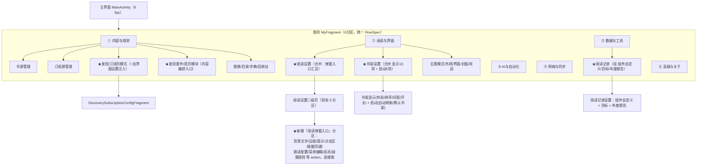

# legado-H 全项目设置体系优化方案

> 范围：**全项目**所有可配置项 —— 主界面 6 大 Tab（首页/书架/发现/订阅/统计/我的）各自内嵌的设置、**阅读页内 30+ 配置弹窗**、漫画/视频/键盘辅助弹窗，以及「我的」页 6 分区 11 二级页。
> 状态：**本文件是早期版本（P 编号体系），已停止更新**；现行结论（R1–R50）与实施进度见 `settings-optimization-plan.html`。
> 日期：2026-11-03（HTML 版更新至 2026-11-04）

---

## 0. TL;DR

legado-H 的「设置」并非只有「我的」页那一套，而是**分散在四个相互割裂的层级**：

1. **「我的」页设置**：6 分区 27 行 → 11 个二级设置页（ConfigTag）→ 1 个三级页（DNS）。
2. **各 Tab 内嵌设置**：书架（13 项显示配置弹窗 + 6 个管理入口）、发现（套件管理 + 页模式/布局）、订阅（列数 + 页模式）、首页（模块管理 + 布局 + 预加载）、统计（组件自定义 + 目标 + 年度报告）。
3. **阅读页内弹窗设置**（本次重点补齐，此前遗漏）：底部两行可自定义菜单 → 两个母弹窗「阅读样式」「更多设置」→ 层层展开的 30+ 个配置弹窗（背景文字/边距/点击区域/翻页键/提示/朗读/高亮规则/段落规则…），另有漫画 3 弹窗、视频设置、键盘辅助。
4. **底部导航自身配置**：6 Tab 的显隐/顺序/图标，挂在「界面设置」二级页。

**核心问题**：第 2、3 层几乎全部游离在全局搜索索引之外，且与「我的」页设置存在大量语义重叠、入口分裂。本方案重点解决「哪些该合并到一个父项、哪些该挪位置」。

---

## 1. 全项目设置现状盘点

### 1.1 主界面 6 Tab 与各自设置入口

| Tab | Fragment | 设置入口 | 设置内容 |
|---|---|---|---|
| 首页 | `HomepageFragment` | 菜单 `menu_homepage` | 模块管理(`HomepageModuleManageSheet` 828 行)、布局切换(混合列表/分源Tab)、预加载开关、刷新 |
| 书架 | `BookshelfFragment1/2` | 菜单 `main_bookshelf` | 书架布局(`BookshelfConfigDialog` 13 项)、分组管理、标签管理、合集、书架管理、库内搜索、导入导出、缓存下载 |
| 发现 | `ExploreFragment` | 菜单 `main_explore`(分组) + 套件管理入口 | 发现套件管理(`DiscoverySuiteManageActivity` 1934 行)、页模式(经典/现代/套件)、页布局(列表/瀑布流/网格) |
| 订阅 | `RssFragment` | 菜单 `main_rss` | 订阅源管理、列数切换(1-3列)、收藏、阅读记录、分组 |
| 统计 | `ReadRecordFragment` | 菜单 `book_read_record` | 年度报告(`YearlyReportActivity`)、组件自定义(`ReadRecordComponentConfigDialog` 7 组件)、目标配置、排行 |
| 我的 | `MyFragment` | 页内 6 分区 | 见 1.2 |

### 1.2 「我的」页 6 分区 27 行

一级分类（`MyFragment.buildSections()`，6 区 27 行）：

- **内容与规则**：bookSourceManage(书源管理)、rssSourceManage(订阅源管理)、replaceManage(替换净化)、txtTocRuleManage(目录规则)、dictRuleManage(字典规则)、sourceRecycleBin(回收站)
- **阅读与界面**：READING_CONFIG(阅读设置)、themeMode(主题模式开关行)、appearanceKit(外观套装)、theme_setting→THEME_CONFIG(界面设置)、COVER_CONFIG(封面设置)、WELCOME_CONFIG(欢迎页设置)
- **AI与自动化**：ai_setting→AI_CONFIG(AI设置)、autoTaskService(自动任务开关行)、autoTaskManage(自动任务管理)
- **网络与同步**：NETWORK_CONFIG(网络设置)、web_dav_setting→BACKUP_CONFIG(备份与恢复)、webService(Web服务开关行)、publicWebRelay(公开中继)
- **数据与工具**：bookmark(书签)、readRecord(阅读记录)、cacheManage(缓存管理)、STORAGE_CONFIG(存储与清理)、fileManage(文件管理)
- **高级与关于**：ADVANCED_CONFIG(高级设置)、about(关于)、exit(退出)

二级设置页（11 个 ConfigTag，全部是 Compose spec 页）：

| ConfigTag | Fragment | 分区 |
|---|---|---|
| READING_CONFIG | ReadingConfigFragment | 内容选择菜单 / 解析引擎 / 离线预载 / 漫画视频 / **书架启动** |
| NETWORK_CONFIG | NetworkConfigFragment | DNS入口 / Web服务 / 连接与请求 / 书源上传 |
| STORAGE_CONFIG | StorageConfigFragment | 默认导入目录 / 清理动作 |
| ADVANCED_CONFIG | AdvancedConfigFragment | 语言 / 渲染性能 / 媒体按键 / 隐私 / 系统更新 + 评论抓取折叠参数 |
| NETWORK_DNS_CONFIG | NetworkDnsConfigFragment | DoH 三级页（唯一三级页） |
| THEME_CONFIG | ThemeConfigFragment | 图标状态栏 / 导航页面 / 外观 / 模板 |
| BACKUP_CONFIG | BackupConfigFragment | 云存储配置 / 备份恢复 |
| AI_CONFIG | AiConfigFragment | AI助手 / AI供应商 / MCP / 联网工具（最大设置页） |
| COVER_CONFIG | CoverConfigFragment | 封面加载 / 封面合集 |
| WELCOME_CONFIG | WelcomeConfigFragment | 欢迎页自定义 |
| DISCOVERY_SUBSCRIPTION_CONFIG | DiscoverySubscriptionConfigFragment | 发现/订阅页模式（当前藏在主题设置的模板分区下） |

### 1.3 阅读页内弹窗设置体系（本次重点补齐）

阅读页 `ReadBookActivity` 底部有**两行可自定义菜单**（`ReadMenuButtonConfig`，`readMenuButtonLayout` 持久化，13 个内置按钮可增删排序，还支持自定义按钮）。其中与「设置」相关的按钮展开出一整套弹窗：

**第一行默认按钮**：搜索 / 自动翻页 / 替换净化 / 夜间主题 / 角色 / 段落规则 / 气泡 / 阅读助手 / AI总结
**第二行默认按钮**：目录 / 朗读 / **阅读样式** / **设置**

| 弹窗 | 文件 | 触发入口 | 承载设置 |
|---|---|---|---|
| 阅读样式 `ReadStyleDialog` | 约 700 行 | 底部「阅读样式」按钮 `showReadStyle()` | 字体/字号/行距/字重/段距/简繁转换/信息 → 子项弹窗 |
| 页面模板 `ReaderTemplateDialog` | 31KB | 同「阅读样式」（用模板时替代 ReadStyleDialog） | 分页模板编排 |
| 背景文字 `BgTextConfigDialog` | 37KB | ReadStyleDialog 内 | 背景图/文字颜色/强调色（9 组预设） |
| 边距 `PaddingConfigDialog` | 18KB | ReadStyleDialog 内 | 上下左右边距/显示裁切 |
| 提示 `TipConfigDialog` | 26KB | ReadStyleDialog「信息」 | 顶部提示/章节名/页码等显示开关 |
| **更多设置** `MoreConfigDialog` | 20KB | 底部「设置」按钮 `showMoreSetting()` | 40+ 项（见下） |
| 点击区域 `ClickActionConfigDialog` | 16KB | MoreConfigDialog 内 | 屏幕分区点击动作 |
| 翻页键 `PageKeyDialog` | 10KB | MoreConfigDialog 内 | 自定义翻页键映射 |
| 内容选择菜单 `ContentSelectMenuConfigDialog` | 12KB | MoreConfigDialog 内 **+ 阅读设置二级页** | 选中文本后的菜单项 |
| 朗读配置 `ReadAloudConfigDialog` | 58KB | 底部「朗读」按钮 | 朗读引擎/语速/音色/背景音 |
| 背景音管理 `ReadAloudBgmManageActivity` | 49KB | ReadAloudConfigDialog 内 | 背景音列表 |
| 发音人组 `SpeakerGroupManageDialog` | 45KB | 朗读相关 | 发音人分组 |
| 引擎选择 `SpeakEngineDialog` | 31KB | 朗读相关 | TTS 引擎 |
| HTTP TTS `HttpTtsEditDialog` | 18KB | 朗读相关 | 自定义 HTTP TTS |
| 菜单编辑 `ReadMenuButtonManageActivity` | 30KB | 三点菜单「菜单编辑」 | 底部菜单按钮编排 |
| 翻页动画 `showPageAnimConfig` | — | 三点菜单「翻页动画」 | 翻页动画样式 |
| 高亮规则 `HighlightRuleManageActivity` | 20KB | 三点菜单「高亮规则」 | 高亮规则管理 |
| 段落规则 `ParagraphRuleManageActivity` | 19KB | 三点菜单「段落规则」 | 段落规则管理 |
| 气泡快速切换 `BubbleQuickSwitchDialog` | — | 底部「气泡」按钮 | 气泡包切换 → BubbleManageActivity |

**MoreConfigDialog 承载的 40+ 项**（这是阅读页最大的一块隐藏设置）：屏幕方向、保持亮屏、隐藏状态栏/导航栏、正文转横排、显示裁切、双页横向、进度条行为、中文排版、两端对齐、底部对齐、适配特殊样式、滚轮翻页、音量键翻页、播放时音量键、长按翻页、触摸灵敏度、点击动作、菜单透明度、自动换源、可选文本、亮度条、无动画滚动、点击图片方式、优化渲染、点击区域配置、禁用返回键、自定义翻页键、展开文本菜单、内容选择菜单、标题附加信息。

**其它页内弹窗**：

| 弹窗 | 文件 | 入口 | 说明 |
|---|---|---|---|
| 漫画页脚 `MangaFooterSettingDialog` | manga/config | `ReadMangaActivity` | 漫画页脚设置 |
| 漫画滤镜 `MangaColorFilterDialog` | manga/config | `ReadMangaActivity` | 色彩滤镜 |
| 漫画电子纸 `MangaEpaperDialog` | manga/config | `ReadMangaActivity` | 电子纸模式 |
| 视频设置 `SettingsDialog` | video/config | 「阅读设置」二级页漫画视频分区 | 视频播放设置 |
| 键盘辅助 `KeyboardAssistsConfig` | widget/keyboard | `KeyboardToolPop` | 键盘辅助配置 |

### 1.4 页面级设置偏好键归属

| 域 | 偏好键 | 载体 | 是否在搜索索引 |
|---|---|---|---|
| 书架显示(13项) | bookshelfLayout / bookshelfSort / bookGroupStyle / showBooknameLayout / bookshelfMargin / bookshelfListItemStyle / bookshelfListIntroLines / showUnread / showBookshelfFastScroller / bookshelfReturnToTopAfterRead / showReadProgress / showWaitUpCount / showLastUpdateTime | `AppConfig` + `BookshelfConfigDialog` | ❌ |
| 书架启动(5项) | showAddToShelfAlert / autoRefresh / onlyUpdateRead / defaultToRead / defaultHomePage | `ReadingConfigFragment`「书架启动」分区 | ✅ |
| 发现 | discoveryPageMode / modernDiscoveryPage / discoveryPageLayout / discoverySuiteConfig / selectedDiscoverySuiteId / mergeDiscoveryRss | `AppConfig` + `DiscoverySubscriptionConfigFragment` | 部分✅ |
| 订阅 | rssSourceLayout / modernRssPage | `AppConfig` + `RssFragment` | 部分✅ |
| 首页 | homepageLayoutMode / homepagePreload | `AppConfig` + `HomepageFragment` | ❌ |
| 统计 | readRecordComponents / readRecordGoalConfig / readRecordRecentSnapshots | `ReadRecordComponents` / `ReadRecordWidgetStore` | ❌ |
| 底部导航 | mainBottomNavItems / mainBottomNavOrderVersion | `MainBottomNavConfig` + `NavigationBarManageActivity` | 部分✅ |
| 阅读页弹窗 | screenOrientation / keepLight / hideStatusBar / hideNavigationBar / doublePageHorizontal / progressBarBehavior / volumeKeyPage / clickImgWay / optimizeRender / contentSelectActions 等 40+ | `PreferKey` + `ReadBookConfig` + 各弹窗 | ❌（仅 contentSelectMenuConfig、videoSetting 两个 action 在阅读设置二级页） |

**关键事实**：书架显示(13项)、首页、统计、**阅读页 40+ 项弹窗**四大块设置**完全不在全局搜索里**，用户搜「书架」「布局」「目标」「翻页」「边距」都找不到。

---

## 2. 现状树状谱系图（全项目）

```mermaid
flowchart TD
    MAIN["主界面 MainActivity（6 Tab）"]

    subgraph TAB_HOME["首页 HomepageFragment"]
        H1["模块管理 HomepageModuleManageSheet（828行）"]
        H2["布局切换 混合列表/分源Tab"]
        H3["预加载开关"]
    end

    subgraph TAB_SHELF["书架 BookshelfFragment1/2"]
        S1["书架布局 BookshelfConfigDialog（13项显示配置）"]
        S2["分组/标签/合集/书架管理"]
    end

    subgraph TAB_EXPLORE["发现 ExploreFragment"]
        E1["套件管理 DiscoverySuiteManageActivity（1934行）"]
        E2["页模式/页布局"]
    end

    subgraph TAB_RSS["订阅 RssFragment"]
        R1["订阅源管理"]
        R2["列数切换 1-3列"]
        R3["页模式"]
    end

    subgraph TAB_STATS["统计 ReadRecordFragment"]
        T1["年度报告"]
        T2["组件自定义（7组件）"]
        T3["目标配置"]
    end

    subgraph TAB_MY["我的 MyFragment（6分区27行）"]
        M1["① 内容与规则"]
        M2["② 阅读与界面"]
        M3["③ AI与自动化"]
        M4["④ 网络与同步"]
        M5["⑤ 数据与工具"]
        M6["⑥ 高级与关于"]
    end

    MAIN --> TAB_HOME & TAB_SHELF & TAB_EXPLORE & TAB_RSS & TAB_STATS & TAB_MY

    M2 --> M2a["阅读设置 ReadingConfigFragment（含「书架启动」分区 + 内容选择菜单/视频设置 action）"]
    M2 --> M2b["界面设置 ThemeConfigFragment（含底部导航显隐）"]
    M2b -.模板分区.-> M2b1["发现/订阅页模式 DISCOVERY_SUBSCRIPTION_CONFIG"]
    M4 --> M4a["网络设置（含 DNS 三级页）"]

    %% ===== 阅读页弹窗体系（独立于 6 Tab 之外，此前遗漏） =====
    READ["阅读页 ReadBookActivity 底部两行可自定义菜单"]
    READ --> RM1["阅读样式按钮 → ReadStyleDialog / ReaderTemplateDialog"]
    RM1 --> RM1a["背景文字 BgTextConfigDialog"]
    RM1 --> RM1b["边距 PaddingConfigDialog"]
    RM1 --> RM1c["提示 TipConfigDialog"]
    READ --> RM2["设置按钮 → MoreConfigDialog（40+ 项）"]
    RM2 --> RM2a["点击区域 ClickActionConfigDialog"]
    RM2 --> RM2b["翻页键 PageKeyDialog"]
    RM2 --> RM2c["内容选择菜单 ContentSelectMenuConfigDialog"]
    READ --> RM3["朗读按钮 → ReadAloudConfigDialog → 背景音/发音人组/引擎/HTTP TTS"]
    READ --> RM4["三点菜单 → 菜单编辑/翻页动画/高亮规则/段落规则"]
    READ --> RM5["气泡按钮 → BubbleQuickSwitchDialog"]

    MANGA["漫画页 ReadMangaActivity"]
    MANGA --> MA1["页脚 MangaFooterSettingDialog"]
    MANGA --> MA2["滤镜 MangaColorFilterDialog"]
    MANGA --> MA3["电子纸 MangaEpaperDialog"]
```

**现状四大割裂（本版核心发现）**：

1. **「书架」设置被拆两处**：13 项显示配置在书架菜单 `BookshelfConfigDialog`，5 项启动配置在「我的 › 阅读设置」二级页「书架启动」分区。
2. **「发现/订阅/首页」布局设置语义重叠却分三处**：发现页布局、订阅列数、首页布局是同一语义，入口分散。
3. **阅读页 40+ 项弹窗设置完全游离**：与「我的 › 阅读设置」二级页语义高度重叠（都是「怎么读」），却只从阅读页底部菜单可达，不进搜索、不可深链。
4. **四大块页面级设置不在搜索索引**：书架显示、首页、统计、阅读页弹窗。

---

## 3. 优化分析表（合并 / 挪动 / 删除 / 重新归类）

| 编号 | 对象 | 现状 | 动作 | 原因 | 优先级 |
|---|---|---|---|---|---|
| **P1** | 书架显示(13项) + 书架启动(5项) | 显示在书架菜单弹窗，启动在「阅读设置」二级页 | **合并** | 同属「书架」域，拆两处让用户两处找 | P0 |
| **P2** | 发现页模式 + 订阅页模式 | 挂在「界面设置›模板」分区 | **改层级 + 重新归类** | 语义属「发现/订阅」内容域，不该在「界面」的「模板」下 | P0 |
| **P3** | 发现页布局 / 订阅列数 / 首页布局 | 三处分散 | **合并/归拢** | 都是「页面布局」同一语义 | P1 |
| **P4** | 首页模块管理 + 发现套件管理 | 首页菜单 + 发现页入口 | **重新归类** | 都是「内容编排」，与「内容与规则」区同域 | P1 |
| **P5** | 阅读页 40+ 项弹窗设置 | 只在阅读页底部菜单可达，不进搜索 | **挂到全局设置 + 进搜索**（本次核心） | 与「阅读设置」二级页语义重叠，用户无法从「我的」或搜索找到 | P1 |
| **P6** | 统计组件自定义 / 目标 / 年度报告 | 统计页内 | **挂到全局设置 + 进搜索** | 组件自定义本质是「阅读记录显示设置」 | P1 |
| **P7** | 底部导航显隐 vs 图标管理 | 显隐在 ThemeConfigFragment，图标在 NavigationBarManageActivity | **保留但标注** | 语义可分，但入口应互链 | P2 |
| A1 | 封面硬编码 key | 9 处裸字符串 | **优化** | 常量已定义未用，拼错静默失效 | P0 |
| A2 | 2 个死键 | cacheManage / updateSourceStrategy 零引用 | **删除** | 死代码 | P0 |
| A3 | 5 个死字符串分类名 | config_category_reading/data_device/sync/tools/appearance | **删除** | 零引用历史遗留 | P0 |
| A4 | PreferKey 命名 | editTemeAuto 拼写错 | **优化** | 命名即 API 面 | P1 |
| O1 | 一级行 key 双轨 | 自定义 key 与 ConfigTag 并存 | **统一** | 消除三处映射手工同步 | P1 |
| O2 | 四处映射一致性 | 手工同步 | **收口** | 移动页面时四处必须同步改 | P1 |

---

## 4. 目标树状谱系图

**目标差异**：
1. 「发现/订阅页模式」从「界面设置›模板」上提到「内容与规则」一级（P2）。
2. 「书架显示 13 项」与「书架启动 5 项」合并为「书架设置」父项（P1）。
3. 「阅读设置」二级页新增「阅读弹窗入口」分区，把阅读页 40+ 项弹窗纳入搜索与深链（P5）。
4. 「统计组件/目标/年度报告」挂到「数据与工具›阅读记录」下，进搜索（P6）。
5. 「发现套件/首页模块」与「内容与规则」区统一（P4）。
6. 删除死键/死字符串、修正命名、RowSpec 收口（A/O 层）。

---

## 5. 修改方案明细

### 5.1 P1 —— 书架设置合并（P0，核心）

**现状**：书架显示 13 项在 `BookshelfConfigDialog`（`ui/main/bookshelf/`），书架启动 5 项在 `ReadingConfigFragment`「书架启动」分区（`ReadingConfigFragment.kt:120-156`）。

**目标**：新建「书架设置」入口，两类归拢。

| 选项 | 做法 | 代价 |
|---|---|---|
| P1-a（推荐，改动小） | 在「阅读与界面」区新增「书架设置」一级行，打开合并页：沿用 `BookshelfConfigDialog` 13 项 + 挪入「书架启动」5 项 | 新建 ConfigTag + Fragment + 三处映射同步 |
| P1-b（最小改动） | 在 `ReadingConfigFragment` 书架启动分区旁加「书架显示设置」跳转 action | 只加一个跳转，「合并」不彻底 |

**影响文件（P1-a）**：`ConfigTag`（新增 BOOKSHELF_CONFIG）、`ConfigActivity.when+breadcrumbOf`、`MyFragment.buildSections+handleRowClick`、`SettingsSearchIndex.pages`、新增 `BookshelfConfigFragment`、`ReadingConfigFragment`（移除书架启动分区）、`BookshelfConfigDialog`（改造或保留）。

**风险**：`BookshelfConfigDialog` 是 `ComposeDialogFragment`，13 项配置的 Compose UI 需抽成可复用 spec 或 Composable。

### 5.2 P2 —— 发现/订阅页模式上提（P0）

`DISCOVERY_SUBSCRIPTION_CONFIG` 从「界面设置›模板」提到「内容与规则」一级。四处映射同步改（ConfigTag 常量已存在无需新增，改 `ConfigActivity.breadcrumbOf` 父级、`MyFragment.buildSections` 新增行、`SettingsSearchIndex` ownerKey）。

**风险**：唯一改变用户入口位置的操作，务必「先增新入口验证后，再移除旧入口」，避免新旧入口都失效。

### 5.3 P3 —— 布局类设置归拢（P1，需决策）

发现页布局(`discoveryPageLayout`)、订阅列数(`rssSourceLayout`)、首页布局(`homepageLayoutMode`) 语义一致。

| 选项 | 做法 |
|---|---|
| P3-a | 三者都收进「发现/订阅页模式」页（改名「页面布局与模式」） |
| P3-b（推荐） | 仅统一命名与搜索别名，不强行挪动入口，避免「首页布局」脱离首页语境 |
| P3-c | 保持现状，仅在方案标注语义重叠 |

### 5.4 P4 —— 内容编排统一入口（P1，需决策）

首页模块管理、发现套件管理、书源/订阅源管理同属「内容编排」。

| 选项 | 做法 |
|---|---|
| P4-a | 「内容与规则」区加「发现套件」「首页模块」入口行 |
| P4-b（推荐） | 保持页面内入口（就近原则），给管理页加全局搜索条目 |

### 5.5 P5 —— 阅读页弹窗进全局设置与搜索（P1，核心价值）

**现状**：阅读页 40+ 项弹窗设置只在底部菜单可达，不进 `SettingsSearchIndex`，与「阅读设置」二级页语义重叠却割裂。

**目标**：`ReadingConfigFragment` 新增「阅读弹窗入口」分区，把关键弹窗以 `SettingActionSpec` 手工声明挂入（与现有 `contentSelectMenuConfig`、`videoSetting` action 同模式），自然进搜索。

**可纳入的弹窗 action**（优先纳入常用项）：

| 弹窗 | 触发方法 | 说明 |
|---|---|---|
| 背景文字 BgTextConfigDialog | `showBgTextConfig()`（在 `BaseReadBookActivity.kt:141`） | 需处理「无打开书籍」的场景 |
| 边距 PaddingConfigDialog | `showPaddingConfig()`（`BaseReadBookActivity.kt:136`） | 同上 |
| 提示 TipConfigDialog | ReadStyleDialog 内 | 需抽独立 action |
| 点击区域 ClickActionConfigDialog | `showClickActionConfig()`（`BaseReadBookActivity.kt:147`） | 同上 |
| 翻页键 PageKeyDialog | 需抽 action | 同上 |
| 朗读配置 ReadAloudConfigDialog | 需抽 action | 同上 |
| 菜单编辑 ReadMenuButtonManageActivity | `startActivity` | 无书籍依赖，可直接挂 |
| 高亮/段落规则 | `startActivity` | 同上 |

**代价（诚实，含技术约束）**：
- **体系不同构（关键约束）**：`MoreConfigDialog`（30 项）是 `BasePrefDialogFragment`，`ReadAloudConfigDialog`（30+ 项）、`BgTextConfigDialog`、`PaddingConfigDialog` 等是 `ComposeDialogFragment`，**都不是 spec 体系**，且其 `buildSpec` 依赖宿主 Activity（`ReadBookActivity`）。因此**不能**简单地「加 3 个 PageSource」并入 `SettingsSearchIndex` —— 那条路径在技术上不成立。
- **可行路径**：在 `ReadingConfigFragment`（spec 体系内）新增「阅读弹窗入口」分区，用 `SettingActionSpec` 逐项**手工声明**弹窗入口（与现有 `contentSelectMenuConfig`、`videoSetting` 两个 action 完全同模式），才能进搜索。每加一个弹窗入口 = 手写一个 action spec。
- **依赖「当前打开书籍」的弹窗**（背景文字/边距/点击区域等）挂到全局设置页时，需处理「无打开书籍」场景（提示「请先打开一本书」或打开后跳转）。
- **深链定位打折**：这些弹窗不在 `ConfigActivity`，点击搜索只能跳到「阅读设置」二级页的 action 行，由用户二次点击。

**建议分期**：先纳入**无书籍依赖**的（菜单编辑/朗读配置/高亮/段落规则），再处理**依赖书籍**的（背景文字/边距/点击区域），后者可做成「点击后提示打开书籍」。

### 5.6 P6 —— 统计设置进搜索（P1）

统计页的组件自定义/目标/年度报告挂到「数据与工具›阅读记录」下。`ReadRecordComponentConfigDialog`、目标配置需抽成 action 或 spec。

### 5.7 A 层 / O 层（零风险，沿用）

- **A1 封面硬编码 key**：`CoverConfigFragment.kt` 第 46/49/51/55/58/60/82/85/87 行用裸字符串 `"loadCoverOnlyWifi"`/`"loadCoverHighQuality"`/`"useDefaultCover"`，而 `PreferKey.kt:26-28` 已定义同名常量，改回 `PreferKey.xxx`。
- **A2 删 2 死键**：`PreferKey.cacheManage`（`PreferKey.kt:167`）、`PreferKey.updateSourceStrategy`（`PreferKey.kt:419`）全库零引用，删除。
- **A3 删 5 死字符串**：`config_category_reading`/`data_device`/`sync`/`tools`/`appearance`（仅 `values/strings.xml` + `values-zh/strings.xml` 定义，其余 8 个本地化目录无，同删不触发 ExtraTranslation）。
- **A4 `editTemeAuto` 改名**：`PreferKey.kt:14` 拼写错误（teme→theme），改常量名 `editThemeAuto`，**保留字符串值 `"editTemeAuto"`** 则零数据迁移。
- **O1 RowSpec 收口**：抽 `RowSpec` 数据类，`buildSections()` 与 `handleRowClick()` 从同一列表驱动。
- **O2 四处映射校验**：ConfigTag / ConfigActivity.when+breadcrumbOf / MyFragment 行 key+跳转 / SettingsSearchIndex.ownerKey 四处同步改。

---

## 6. 校验结果

| 断言 | 结论 | 证据 |
|---|---|---|
| 书架显示 13 项 + 启动 5 项分裂 | ✅ 成立 | 显示在 `BookshelfConfigDialog`+`BaseBookshelfFragment.configBookshelf()`；启动在 `ReadingConfigFragment.kt:120-156` |
| 发现/订阅页模式层级错位 | ✅ 成立 | `ThemeConfigFragment` 模板分区跳转；ownerKey=`theme_setting` |
| 发现/订阅/首页三处布局设置分散 | ✅ 成立 | `discoveryPageLayout`/`rssSourceLayout`/`homepageLayoutMode` 三键三入口 |
| 阅读页弹窗体系完整存在且游离搜索 | ✅ 成立 | `ui/book/read/config/` 30+ 弹窗，`SettingsSearchIndex.pages` 仅 11 个 PageSource |
| 首页/统计/书架显示不在搜索索引 | ✅ 成立 | 同上 |
| 主界面 6 Tab | ✅ 成立 | `MainActivity.kt` `realPositions = [homepage, bookshelf, explore, rss, readRecord, my]` |
| 底部导航可自定义 | ✅ 成立 | `MainBottomNavConfig` 6 key + `mainBottomNavItems` + `NavigationBarManageActivity` |
| A1 封面硬编码 key | ✅ 成立 | `CoverConfigFragment.kt:46-87` 裸字符串 vs `PreferKey.kt:26-28` 常量 |
| A2 两个死键 | ✅ 成立 | `PreferKey.cacheManage`/`updateSourceStrategy` 全库零引用 |
| A3 五个死字符串 | ✅ 成立 | 仅 values+values-zh 定义，代码零引用，其余 8 本地化目录无 |
| A4 editTemeAuto 拼写错 | ✅ 成立 | `PreferKey.kt:14`，引用点 5 处 |

---

## 7. 建议实施顺序

1. **A 层**（A1+A2+A3+A4，零风险先做）
2. **P2**（发现/订阅页模式上提，先增后删四处同步）
3. **P1**（书架设置合并，需先决策 P1-a/P1-b）
4. **P5**（阅读弹窗进搜索，先做无书籍依赖项）
5. **P6**（统计设置进搜索）
6. **P3/P4**（布局归拢 / 内容编排统一，需产品拍板）
7. **O1/O2**（RowSpec 收口 + 映射校验）
8. **二期**：阅读弹窗依赖书籍项、首页设置进搜索

---

## 8. 自查清单

### A 层
- [ ] `grep -n 'booleanSetting("' CoverConfigFragment.kt` 无裸字符串残留
- [ ] `grep -rn 'PreferKey.cacheManage\|PreferKey.updateSourceStrategy' app/src/main` 为空
- [ ] `grep -rn 'editTemeAuto' app/src/main` 为空（改名为 editThemeAuto 后）
- [ ] 5 个死字符串在 `app/src` 零引用，values + values-zh 已同删
- [ ] `./gradlew :app:compileAppDebugKotlin` BUILD SUCCESSFUL

### P2（发现/订阅上提）
- [ ] 「内容与规则」出现「发现/订阅页模式」行，点击打开 DiscoverySubscriptionConfigFragment
- [ ] 面包屑「内容与规则›发现/订阅页模式」；ThemeConfigFragment「模板」分区无残留入口
- [ ] 搜索「发现/订阅/模式」命中并跳转正确一级行

### P1（书架合并）
- [ ] 书架显示 13 项与启动 5 项归拢到同一入口，旧入口无残留死链

### P5（阅读弹窗进搜索）
- [ ] 阅读设置二级页出现「阅读弹窗入口」分区，各 action 可打开对应弹窗
- [ ] 无书籍依赖项（菜单编辑/朗读/高亮/段落）正常打开；依赖书籍项在无书籍时给提示
- [ ] 搜索「背景/边距/翻页/朗读/高亮/段落」能命中

### P5/P6（搜索索引）
- [ ] 新增 PageSource 的 ownerKey 指向真实存在的一级行 key
- [ ] `verifySubSearchOwners` 不崩；搜索「书架/布局/目标/组件」能命中

### 回归
- [ ] 6 Tab 切换正常；各 Tab 菜单项不重复不缺失
- [ ] 「我的」页 6 分区无空白行/死行
- [ ] 真机：阅读页底部菜单/阅读样式/更多设置正常打开；搜索封面/书架/发现/订阅/DNS 命中与跳转；切主题模式不崩
