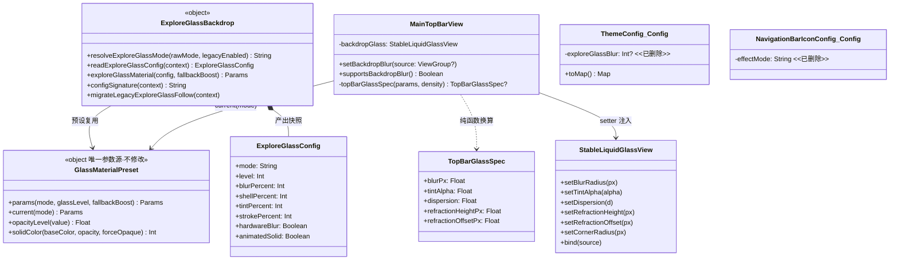
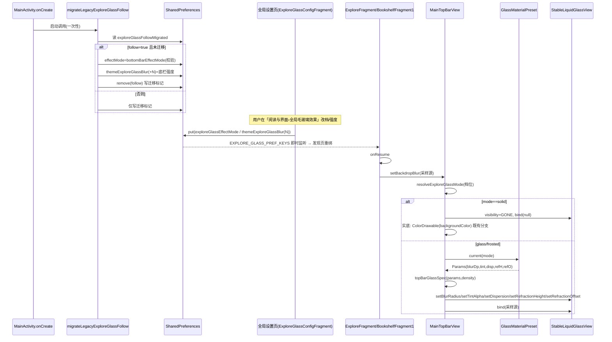
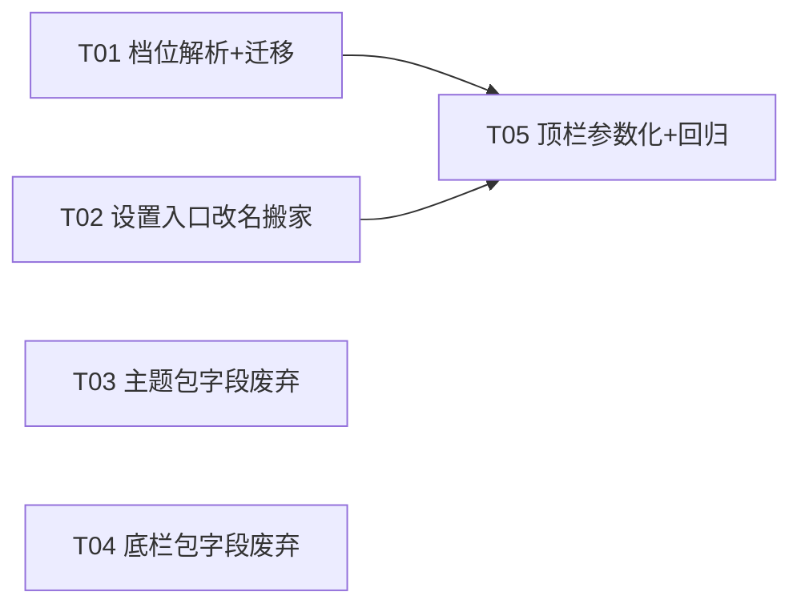

# 毛玻璃效果设置项重构 — 架构设计（高见远 / Architect）

> 仓库：`/Users/zego/个人/github/legado-H` · Android / Kotlin · 遵守已拍板决策 D1–D4
> 设计前已用 Grep/Read 逐点核实代码现状，文中行号均为实测，可直接采信。

---

## Part A：系统设计

### 1. 实现方案与关键设计决策

**总体思路**：本次重构是「作用域收拢」——毛玻璃材质三档的唯一参数源 `GlassMaterialPreset` 已存在（底栏 + 发现页共用），本期把「顶栏」接入同一预设（D4），把「主题包编辑 / 底栏包编辑里的局部毛玻璃控件」删掉并入全局（需求 2/3），把旧包字段彻底废弃（D1/D2），把「跟随底栏」开关移除并做好一次性迁移（D3），最后做设置入口的改名与搬家（需求 1）。**不新增任何独立毛玻璃参数键**，全部复用既有 `exploreGlassEffectMode` / `themeExploreGlassBlur(日/夜)` / 四倍率键 / `GlassMaterialPreset`。

#### 决策 1：一级行 key / ConfigTag 常量**不改名**

- 结论：保留 `ConfigTag.EXPLORE_GLASS_CONFIG = "exploreGlassConfig"`，只改「分区归属 + 面包屑 + 显示文案」。
- 理由：① 一级行 key 同时是设置搜索深链的 ownerKey，`SettingsSearchIndex.kt` L87 的 `PageSource(EXPLORE_GLASS_CONFIG, EXPLORE_GLASS_CONFIG)` 与 `tools/check_settings_mapping.py` 强校验（17 个 Tag 全覆盖）都锚定该 key；② 改名无用户可见收益（用户看到的是 title 字符串，不是 key）；③ 跨分区搬行在 `MyFragment.kt` KDoc 中被明确声明为安全操作（"行在哪个分区不影响深链"），而改 key 是危险操作。风险收益完全倒挂，最小变更原则下不改名。
- 落点：`MyFragment.buildSections()` 中 `EXPLORE_GLASS_CONFIG` actionRow（L329-334）从「内容与规则」分区移到「阅读与界面」分区；`ConfigActivity.breadcrumbOf()` L211-212 改为 `listOf(R.string.config_category_reading_ui)`（与 MyFragment 分区标题同源，满足 KDoc 约束）；显示标题 `explore_glass_settings_title` 改为「全局毛玻璃效果」（双语）。

#### 决策 2：`exploreGlassFollowBottomBar` 迁移策略——**启动时一次性固化（档位 + 强度双固化）**

- 结论：新增一次性迁移 `migrateLegacyExploreGlassFollow(context)`（放 `ExploreGlassBackdrop.kt`，纯偏好读写，启动时由 `MainActivity.onCreate` 调用一次），逻辑：
  1. 迁移标记键 `exploreGlassFollowMigrated=true` 已存在 → 直接返回（幂等）；
  2. 读旧键 `exploreGlassFollowBottomBar`，`false`/缺失 → 只写迁移标记，不动任何值；
  3. `true` → 把底栏当前状态**固化为显式档位**：
     - `exploreGlassEffectMode = AppConfig.bottomBarEffectMode`（校验 ∈ `GlassMaterialPreset.modes`，非法回退默认 frosted）；
     - `themeExploreGlassBlur` 与 `themeExploreGlassBlurN` 同时写为底栏对应强度（frosted → `AppConfig.frostedGlassLevel`，否则 `AppConfig.liquidGlassLevel`）；
  4. `removePref(exploreGlassFollowBottomBar)`，写迁移标记。
- 理由：
  - **档位固化**：跟随开启时生效档位 = 底栏档位（`resolveExploreGlassMode` L104-107），固化即等价还原；
  - **强度必须一起固化**：跟随开启时强度也取底栏的 `frostedGlassLevel/liquidGlassLevel`（`exploreGlassMaterial` L272-273），若只固化档位、强度回落到页面自己的 `themeExploreGlassBlur`，升级后观感会变——违反"迁移不破坏升级用户"约束。而页面强度键在跟随期间**本来就不生效**，覆写它不会丢失任何用户可见状态；
  - **选"一次性迁移"而非"读取时兜底"**：D3 之后 `resolveExploreGlassMode` 与 `ExploreGlassConfig` 彻底去掉 follow 参数，渲染路径零残留；读取时兜底会让废弃键永远活在解析函数里，与"彻底移除"的目标冲突。启动迁移（参考 `ThemeRuntimeKeys.migrateLegacyNightValues` 的成熟范式）执行在 UI 之前，无需运行时兜底。
- `PreferKey.exploreGlassFollowBottomBar` 常量**保留**（迁移代码要读旧键），KDoc 标注「1.25.x 已废弃，仅供一次性迁移读取」；同时从 `ExploreGlassConfigKeys.settingKeys` 移除（不再进监听/重置/签名集合）。

#### 决策 3：顶栏 solid 档行为——**走实底，不激活玻璃层**

- 结论：`resolveExploreGlassMode` 解析为 solid 时，`MainTopBarView.setBackdropBlur` 保持 `backdropGlassActive=false`（`backdropGlass` 隐藏），顶栏底由既有路径兜住：`applyDefaultStyle/applyRegularStyle` L361-365 / L411-415 中 `overlayOpaqueBackground && !backdropGlassActive → ColorDrawable(context.backgroundColor)`，即完全不透明贴主题底色。
- 理由：与发现页「无玻璃」档语义完全一致（"贴主题底色的完全不透明纯色块，不透壁纸/列表"），且**零新增渲染代码**—— solid 档不激活时这条既有分支自动接管。glass/frosted 档激活 `backdropGlass`，参数从 `GlassMaterialPreset.current(mode)` 换算（见 §4），替换原硬编码 18dp/0.10/0.10/14dp/26dp。
- 事实澄清（实测）：两个宿主当前调用都是 `setBackdropBlur(null)`（`ExploreFragment.kt` L1931、`BookshelfFragment1.kt` L198），玻璃层当前处于未激活状态；D4 参数化改动只针对"激活时用什么参数"，不改变激活条件本身，宿主传 null 的行为不变。

#### 决策 4：旧包字段废弃的落点

- **主题包 `exploreGlassBlur`**（`ThemeConfig.Config` L1144）：
  - 删字段 + `equals` L1186 + `toMap` L1224 各删一行 → 导出侧（`toMap`）自然不再含 `exploreGlassBlur`，D2 满足；
  - 导入侧：Gson 反序列化对 JSON 中的未知字段天然静默忽略 → D1 满足，**不写任何读取兼容代码**；
  - 同步删：`ThemeConfig` 应用写入 `applyExtendedInterfaceColors` L800-802、merge 回填 L749；`ThemeManageActivity` 的 `pendingExploreGlassBlur`/`exploreGlassBlurAtEditStart`（L181-182）、读偏好 L506-510、btnCancel 恢复 L604-607、`setupInterfaceRows` 调用 L658、`applyThemeEditFonts` 标题列表 L719、`setupExploreGlassBlurRow` L809-834、`saveTheme` 写入 L1305、`readThemeConfig` 读取 L1472-1475；布局 `dialog_theme_package_edit.xml` 的 `<include android:id="@+id/row_explore_glass_blur">`（L196-199，指向 `item_theme_package_slider`）整块删除；字符串 `theme_explore_glass_blur`（values-zh L2146「发现页毛玻璃效果」/ values L2434）删除。
  - 注意：**全局强度键 `themeExploreGlassBlur/themeExploreGlassBlurN` 本身保留**（全局设置页仍用），`BackupConfig.themePrefKeys` L130-131 与 `ThemeRuntimeKeys.legacyNightPairs` L32 / `allKeys` L156-157 均**不动**——废弃的只是主题包 JSON 字段，不是偏好键。
- **底栏包 `effectMode`**（`NavigationBarIconConfig.Config` L110）：
  - 删字段；所有引用点同步删：
    - `apply()` L230、`applyCurrentBottomConfig()` L248：删 `AppConfig.bottomBarEffectMode = config.effectMode`（应用底栏包不再覆盖全局材质档，D1）；
    - `normalizeConfig` L1321-1324/L1332：删 effectMode 归一段；
    - `standardEntryForKit` L272、`migrateLegacyIconsIfNeeded` L1426、`NavigationBarManageActivity.showEditDialog` L448 等默认构造：删该具名参数；
    - `NavigationBarManageActivity`：材质样式选项行 L534-550、`normalizeStandardBottomConfig` L678-682、`effectModeLabel` L1083-1089、`entryInfo` 材质标签 L1110-1113 全删；字符串 `bottom_bar_material_mode` 与 `bottom_bar_effect_solid/glass/frosted`（删行后无引用，已 grep 核实）双语成对删除；
  - **渲染层确认零改动**（实测）：`MainActivity.setupLiquidGlass()` L1562 读全局 `AppConfig.bottomBarEffectMode`；standard 布局在 L1563-1581 的 `standardMode` 分支**先于** effectMode 判断 return，不依赖包字段。删字段后 standard 包应用时不再把全局钉成 solid，但 standard 渲染分支本就独立于 effectMode，观感不变；floating 包应用后全局档位保持用户全局设置（这正是 D1 的语义）。
- 主题包/底栏包 JSON 中旧字段是"数据废弃"，不是"键值废弃"——无需迁移标记键，Gson 忽略即可。

### 2. 文件列表

| 文件（相对路径） | 改动要点 |
|---|---|
| `app/src/main/java/io/legado/app/constant/PreferKey.kt` | `exploreGlassFollowBottomBar` KDoc 标注废弃（保留常量供迁移读取）；新增迁移标记键 `exploreGlassFollowMigrated` |
| `app/src/main/java/io/legado/app/ui/main/explore/ExploreGlassBackdrop.kt` | `resolveExploreGlassMode` 新签名去 follow 参数；`ExploreGlassConfig` 删 `followBottomBar` 字段；`ExploreGlassConfigKeys` 删 `followBottomBar` 成员并移出 `settingKeys`；`readExploreGlassConfig` 删 follow 读取；`exploreGlassMaterial` 删跟随分支；`configSignature` 删 follow 项；新增 `migrateLegacyExploreGlassFollow()` |
| `app/src/main/java/io/legado/app/ui/config/ExploreGlassConfigFragment.kt` | 删「跟随底栏材质」开关项与所有 follow 联动（enabled/summary 分支 L71-76、L88-101、开关项 L166-175） |
| `app/src/main/java/io/legado/app/ui/main/my/MyFragment.kt` | `EXPLORE_GLASS_CONFIG` actionRow 从「内容与规则」移入「阅读与界面」分区，注释同步改 |
| `app/src/main/java/io/legado/app/ui/config/ConfigActivity.kt` | `breadcrumbOf` L211-212 改归 `config_category_reading_ui` |
| `app/src/main/res/values-zh/strings_explore_glass.xml` | 标题改「全局毛玻璃效果」；summary 改全局口径；删 follow 两条（L16-17、L21）；`explore_glass_level_summary` 删「编辑主题」提及 |
| `app/src/main/res/values/strings_explore_glass.xml` | 同上英文版成对改 |
| `app/src/main/java/io/legado/app/ui/main/MainActivity.kt` | `onCreate` 调用 `migrateLegacyExploreGlassFollow()`（一次，早于任何 UI） |
| `app/src/main/java/io/legado/app/help/config/ThemeConfig.kt` | `Config.exploreGlassBlur` 删字段 + equals L1186 + toMap L1224；`applyExtendedInterfaceColors` L800-802 删；merge L749 删 |
| `app/src/main/java/io/legado/app/ui/config/ThemeManageActivity.kt` | 删 pendingExploreGlassBlur/exploreGlassBlurAtEditStart、L506-510 / L604-607 / L658 / L719 / L809-834 / L1305 / L1472-1475 |
| `app/src/main/res/layout/dialog_theme_package_edit.xml` | 删 `row_explore_glass_blur` include 块（L196-199） |
| `app/src/main/res/values-zh/strings.xml`、`app/src/main/res/values/strings.xml` | 主题包侧删 `theme_explore_glass_blur`；底栏侧删 `bottom_bar_material_mode`、`bottom_bar_effect_solid/glass/frosted`（双语成对） |
| `app/src/main/java/io/legado/app/help/config/NavigationBarIconConfig.kt` | `Config.effectMode` 删字段；`apply`/`applyCurrentBottomConfig`/`normalizeConfig`/默认构造（L230/L248/L1321-1324/L1332/L272/L445/L718/L1426）同步删 |
| `app/src/main/java/io/legado/app/ui/config/NavigationBarManageActivity.kt` | 删材质样式行 L534-550、`normalizeStandardBottomConfig` L678-682、`effectModeLabel` L1083-1089、`entryInfo` 材质标签 L1110-1113、默认构造 L448 |
| `app/src/main/java/io/legado/app/ui/widget/MainTopBarView.kt` | `setBackdropBlur` 参数化：solid → 不激活（走既有实底分支）；glass/frosted → `GlassMaterialPreset.current(mode)` 换算；新增 internal 纯函数 `topBarGlassSpec(params, density): TopBarGlassSpec?` 与 `topBarGlassSignature()`（含档位+两强度，供 styleSignature 失效判断） |
| `app/src/main/java/io/legado/app/ui/main/explore/ExploreFragment.kt`、`app/src/main/java/io/legado/app/ui/main/bookshelf/style1/BookshelfFragment1.kt` | onResume 链路确保 `updateModernTopBarOverlay()/updateTopBarOverlay()` 被调用（全局改档返回主界面后 `setBackdropBlur` 重算） |
| `app/src/test/java/io/legado/app/ui/main/explore/ExploreGlassHardwareBlurTest.kt` | 见 §5 测试策略 |
| `app/src/test/java/io/legado/app/ui/widget/TopBarGlassSpecTest.kt`（新增） | 顶栏参数换算纯函数用例 |
| `tools/check_settings_mapping.py` | 不改，作为验收门槛执行 |

### 3. 数据结构与调用流程

#### 档位解析新签名（ExploreGlassBackdrop.kt）

```kotlin
// 旧: resolveExploreGlassMode(rawMode, legacyEnabled, followBottomBar, bottomBarMode)
// 新: 跟随底栏参数整体移除；旧总开关迁移保留
internal fun resolveExploreGlassMode(rawMode: String?, legacyEnabled: Boolean): String
// 规则: stored(∈modes, "none"→solid) 优先 → legacyEnabled=false 迁移 solid → 默认 frosted

internal data class ExploreGlassConfig(
    val mode: String, val level: Int,
    val blurPercent: Int, val shellPercent: Int,
    val tintPercent: Int, val strokePercent: Int,
    val hardwareBlur: Boolean, val animatedSolid: Boolean
    // followBottomBar 字段删除
)

internal fun exploreGlassMaterial(
    config: ExploreGlassConfig,
    fallbackBoost: Float = GlassMaterialPreset.fallbackBoost()
): GlassMaterialPreset.Params =
    // 跟随分支删除，恒走 GlassMaterialPreset.params(mode, opacityLevel(level), fallbackBoost)
```

#### 顶栏参数换算（MainTopBarView.kt 新增，纯 JVM）

```kotlin
internal data class TopBarGlassSpec(
    val blurPx: Float, val tintAlpha: Float, val dispersion: Float,
    val refractionHeightPx: Float, val refractionOffsetPx: Float
)

/** solid 档返回 null（不激活玻璃层）；glass/frosted 档与预设 1:1，不重定义任何公式。 */
internal fun topBarGlassSpec(
    params: GlassMaterialPreset.Params, density: Float
): TopBarGlassSpec? = when (params.mode) {
    GlassMaterialPreset.SOLID -> null
    else -> TopBarGlassSpec(
        blurPx = params.blurDp * density,
        tintAlpha = params.tintAlpha,
        dispersion = params.dispersion,
        refractionHeightPx = params.refractionHeightDp * density,
        refractionOffsetPx = params.refractionOffsetDp * density
    )
}
```

`setBackdropBlur(source)` 新流程：`active = source != null && supportsBackdropBlur()`；active 时 `resolveExploreGlassMode(pref(exploreGlassEffectMode), pref(exploreGlassEnabled))` → solid 则 `backdropGlassActive=false`（实底兜底）；否则 `topBarGlassSpec(GlassMaterialPreset.current(mode), density)` 非空 → 依次 `setCornerRadius(TopBarConfig 圆角，不变)` / `setBlurRadius` / `setTintAlpha` / `setDispersion` / `setRefractionHeight` / `setRefractionOffset` / `bind(source)`。圆角仍取 TopBarConfig，与材质无关。

#### 渲染刷新链路（文字时序）

1. **全局改档**：设置页写 `exploreGlassEffectMode`/`themeExploreGlassBlur(N)` → `EXPLORE_GLASS_PREF_KEYS` 即时监听触发发现页重绑（既有）；`configSignature()`（删 follow 项后）在 onResume 兜底重绘。
2. **返回主界面**：`ExploreFragment/BookshelfFragment1.onResume → update*TopBarOverlay() → topBar.setBackdropBlur(源)` → 重读全局档位与强度 → `applyTopBarStyle` 的 signature 扩展了 `topBarGlassSignature()`（mode|frostedGlassLevel|liquidGlassLevel|夜态），档位或强度变化即失效重算 → 顶栏毛玻璃参数即时生效，未变化则跳过重绑。

#### 类图



#### 时序图



### 4. Anything UNCLEAR（均已自行核实，仅列假设）

1. **假设**：`ThemeConfig` L749 所在的 merge 函数（导入配置与已存配置回填）删除 exploreGlassBlur 行即可，无其他字段耦合（已 grep 全部 5 处引用，无遗漏）。
2. **假设**：`ExploreFragment.updateModernTopBarOverlay()` / `BookshelfFragment1.updateTopBarOverlay()` 在 onResume 均被调用（工程落 T05 时以真机验证「全局改档→返回→顶栏生效」；若 onResume 缺调用则补一行）。
3. 顶栏参数化后 glass/frosted 观感与旧硬编码（18dp 等）不同——这是 D4 的预期结果（统一参数源），非回归。
4. 主题包 JSON 里旧 `exploreGlassBlur` 字段、底栏包 JSON 里旧 `effectMode` 字段升级后残留在用户本地文件中，Gson 静默忽略、不清洗不回写（符合"静默忽略"字面义，最小变更）。

---

## Part B：任务分解

### 5. Required Packages

无新增第三方依赖（全部复用现有 Kotlin / AndroidX / Compose / Gson），故不列 package 清单。

### 6. Task List（≤5，按依赖排序）

**T01 档位解析简化 + 跟随开关移除 + 一次性迁移**（基础设施，P0）
- 文件：`ExploreGlassBackdrop.kt`、`ExploreGlassConfigFragment.kt`、`PreferKey.kt`、`MainActivity.kt`、`ExploreGlassHardwareBlurTest.kt`
- 要点：`resolveExploreGlassMode` 新签名；`ExploreGlassConfig/Keys/EXPLORE_GLASS_SETTING_KEYS` 去 follow；设置页删开关与联动；新增 `migrateLegacyExploreGlassFollow()`（幂等、双固化）并在 `MainActivity.onCreate` 调用；单测同步。
- 验收：档位解析 21 条口径改后全绿；迁移用例（follow=true 固化档位+强度、false 不动、幂等、非法底栏档回退 frosted）通过。
- 依赖：无。

**T02 设置入口重命名与搬家（双语 + 面包屑）**（P0，可与 T01 并行）
- 文件：`MyFragment.kt`、`ConfigActivity.kt`、`values-zh/strings_explore_glass.xml`、`values/strings_explore_glass.xml`
- 要点：actionRow 移入「阅读与界面」分区；`breadcrumbOf` 改 `config_category_reading_ui`；标题改「全局毛玻璃效果 / Global glass effect」、summary 全局口径；删 follow 相关文案；`explore_glass_level_summary` 删「编辑主题」提及。
- 验收：`python3 tools/check_settings_mapping.py` 通过（key 未改名）；中文/英文文案成对一致。
- 依赖：无（文案层独立，随 T01 的键删除最终合流）。

**T03 主题包 exploreGlassBlur 废弃（D1/D2）**（P0，可与 T01/T02 并行）
- 文件：`ThemeConfig.kt`、`ThemeManageActivity.kt`、`dialog_theme_package_edit.xml`、`values-zh/strings.xml`、`values/strings.xml`
- 要点：删字段/equals/toMap/apply/merge；删编辑页滑杆行全部代码与布局 include；删 `theme_explore_glass_blur` 字符串；验证导出 JSON 无该字段、导入含该字段的旧 JSON 不报错且不落偏好。
- 验收：导出主题包 JSON 无 `exploreGlassBlur`；导入 1.25.x 旧包成功且全局毛玻璃偏好不被覆盖。
- 依赖：无。

**T04 底栏包 effectMode 废弃（D1）**（P0，可与 T01/T02/T03 并行）
- 文件：`NavigationBarIconConfig.kt`、`NavigationBarManageActivity.kt`、`values-zh/strings.xml`、`values/strings.xml`
- 要点：删字段及 apply/normalizeConfig/默认构造引用；删编辑页「材质样式」行、`normalizeStandardBottomConfig`、`effectModeLabel`、entryInfo 材质标签；删 `bottom_bar_material_mode` 与 `bottom_bar_effect_*` 三条字符串；应用底栏包不再覆盖 `AppConfig.bottomBarEffectMode`。
- 验收：应用 floating 底栏包后全局材质档不变；standard 包渲染分支观感不变（`MainActivity.setupLiquidGlass` 零改动）；grep 全仓无 `config.effectMode` 残留。
- 依赖：无。

**T05 顶栏毛玻璃参数化（D4）+ 全量回归**（P1）
- 文件：`MainTopBarView.kt`、`ExploreFragment.kt`、`BookshelfFragment1.kt`、新增 `TopBarGlassSpecTest.kt`、`tools/check_settings_mapping.py`（执行）
- 要点：`topBarGlassSpec` 纯函数 + `topBarGlassSignature` 扩展 signature；solid→实底不激活；glass/frosted→预设参数注入；确认/补齐 onResume 刷新链路。
- 验收：① 单测：solid 返回 null；glass/frosted 与 `GlassMaterialPreset.params` 1:1（blur=blurDp×density、tint/dispersion 直传、折射=dp×density）；② 真机：全局改档→返回发现页/书架→顶栏即时生效；solid 档顶栏不透列表；③ `check_settings_mapping.py` + `ExploreGlassHardwareBlurTest` 全绿；④ 全 APK 编译通过、grep 无 followBottomBar 渲染引用。
- 依赖：T01（解析函数）、T02（文案）。

### 7. 共享知识（跨文件约定，需写进 KDoc）

1. **毛玻璃新增作用域一律复用 `GlassMaterialPreset`，禁止新增独立参数键**（写进 `MainTopBarView` 顶栏段 KDoc）。
2. 主题包/底栏包 JSON 的**未知字段靠 Gson 静默忽略**实现废弃兼容，禁止写读取兼容/字段回写代码（写进 `ThemeConfig.Config` 与 `NavigationBarIconConfig.Config` KDoc）。
3. 偏好键废弃范式：**保留 PreferKey 常量 + KDoc 标注废弃 + 启动一次性迁移 + 迁移标记键**（参考 `exploreGlassFollowBottomBar` 与 `ThemeRuntimeKeys.migrateLegacyNightValues`）。
4. `MyFragment` 一级行 key = 搜索深链 ownerKey：跨分区搬行安全、改 key 必须同步 `SettingsSearchIndex` 并过 `check_settings_mapping.py`。
5. 双语字符串成对改；删除字符串条目前先全仓 grep 确认零引用。
6. `GlassMaterialPreset` 既有公式口径**不得修改**（观感不变约束），新增作用域只做消费端换算。
7. 所有日期/数值偏好沿用既有键与语义（`themeExploreGlassBlur` 日夜分离键不动，`BackupConfig.themePrefKeys`/`ThemeRuntimeKeys.legacyNightPairs/allKeys` 不动）。

### 8. 测试策略（`ExploreGlassHardwareBlurTest.kt`）

| 用例 | 处理 |
|---|---|
| `followBottomBarMapsThreeModesAndOverridesStoredMode` (L237) | **删除**（跟随映射不复存在） |
| `modeResolutionCoversDefaultsLegacyAndDirtyValues` (L203) | **改写**：调用去掉 follow/bottomBarMode 实参，补「显式档位优先级不变」断言 |
| `prefKeysCoverEveryRowAffectingSetting` (L448)、`everyActuallyReadOrWrittenPrefKeyIsCoveredByRebindListener` (L498) | **改写**：键集合断言移除 `exploreGlassFollowBottomBar`（L31-33 区域的键清单同步） |
| `exploreMaterialReadsSharedPresetWithLocalStrength` (L257) | **改写**：删跟随强度取底栏分支断言，锁「恒走本页强度」 |
| 其余 17 条预设/倍率/实底/渲染口径用例 | **不动**（公式口径未变） |
| 新增（T01） | 迁移函数 4 条：follow=true 双固化、follow=false 不动、幂等、非法底栏档回退 frosted |
| 新增（T05，`TopBarGlassSpecTest.kt`） | solid→null；glass/frosted 五参数与 `GlassMaterialPreset.current` 1:1；密度换算正确 |
| `tools/check_settings_mapping.py` | T02/T05 必须通过（17 Tag 全覆盖强校验） |

### 9. 任务依赖图


T01–T04 相互独立可并行；T05 依赖 T01/T02，实现顺序建议 T01 → (T02‖T03‖T04) → T05。
