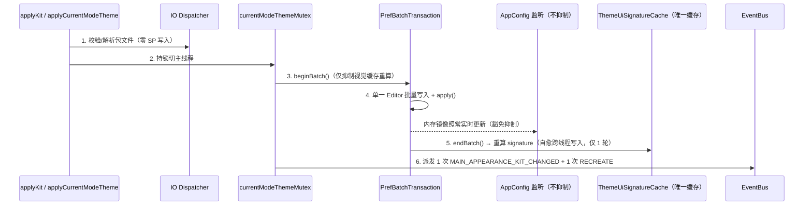

# legado-H UI 配置与界面管理重构详细设计稿（方案 B+ · v3 定稿版）

> [!IMPORTANT]
> 本版（v3）已逐条合入代码实测核查的全部修补：**6 大槽位显式键集（含 THEME 七元组与 WELCOME `welcomeShowTime`）**、**迁移后 baseline 对齐**、**P0-2 抑制边界与 `ThemeUiSignatureCache` 复用**、**P1-4 真实 35% 实测覆盖率与 M2a 后重测清单**、**P1-5 `ActivitySearchSource` 每页自述 + 类名白名单**、**备份 `kits.json` 实盘对账**、**`kitVersion` 升至 2**、**M1b 绑定 `PrefBatchTransaction` 首个生产接入点**。

> [!NOTE]
> **当前落地状态**：本稿定稿时仓库无代码改动；此后工作区已出现 M0 骨架——`lib/theme/AppearanceEnv.kt`、`ResolvedThemeTokens.kt`（含 `GlassTokenRef`）、`ThemeTokenCompiler.kt` 与 `ThemeTokenCompilerTest.kt`；`LegadoComposeTheme` 已注入 `LocalLegadoTokens`（带嵌套幂等守卫），试点接入 `SettingSpecScreen` 与 `AppDialogFrame`。**尚未编译、未跑单测、未装机验证**，验收口径仍以第三节 M0 行为准。

---

## 一、全量核查修补清单（v2 → v3）

| 项 | v2 遗留问题 | v3 定稿修补 |
| :--- | :--- | :--- |
| **P0-1 判脏与槽位键集** | 仅比 `ComponentRef` 漏报自定义改色；首启迁移误报脏；`COVER` 漏模式键、`WELCOME` 漏 `welcomeShowTime` | ① 写死 **6 大槽位完整键集**（THEME 复用 `ThemeModeSnapshot` 七元组，GLASS 含 `glassPresetMatched`）；② 启动迁移/水合结束后执行 **baseline 对齐**，剔除迁移脏源 |
| **P0-2 事务与缓存边界** | 未写明 `AppConfig` 监听豁免；`endBatch` 无条件 invalidate 有跨线程陈旧风险；与 `ThemeUiSignatureCache` 并列违背 R2 | ① 抑制标记**仅作用于视觉缓存**，`AppConfig.onSharedPreferenceChanged` 照常执行；② `endBatch()` 执行**重算 signature** 自愈；③ `ThemeTokenCompiler` 直接复用 `ThemeUiSignatureCache`，绝不另起第二套缓存 |
| **P0-3 玻璃单表** | 已成立 | 维持：Tokens 仅存 `GlassTokenRef(mode/level/strokeColor/signature)`，渲染参数唯一来源 [GlassMaterialPreset.kt](file:///Users/zego/个人/github/legado-H/app/src/main/java/io/legado/app/ui/main/GlassMaterialPreset.kt) |
| **P1-4 Compose 覆盖率** | 估算 85% 偏高 | 写死实测基线：全仓含 `setContent` **176 文件**（已包 29）；5 大收口点触及约 **60 文件（~35%）**；M2a 合并后当场跑静态脚本导出精确残余清单（约 85–100 文件），M2b 按 `≤ 20 文件/commit` 分 5+ 批收尾 |
| **P1-5 搜索路由与自述** | 静态表退回被否掉的影子索引；`Class<out Activity>` 在 JVM 单测无法构造 | 改为 `interface ActivitySearchSource` **每页自述**；`SearchDestination.Activity` 存**类名字符串 + 白名单校验**，纯 JVM 单测可直接构造与断言 |
| **P1-6 原地改造生命周期** | 未注明中间态衔接 | M1/M2 期间**保留** `AppearanceKitEditActivity` 不删；M3 接管 `AppearanceKitActivity:278/312`（编辑、另存）两处入口后再一并删除 |
| **3 项新缺口** | 备份缺对账与临时目录排除；`kitVersion` 未 bump；M1a 事务无调用方空转绿 | ① `UiPackageBackup` 加 `APP_THEME_KITS` + `excludedDirs` 加 `appearanceKitTemp` + 恢复后 `kits.json` 实盘对账；② `kitVersion` 升至 **2**（保留 v1 只读）；③ M1b 明确接入 `applyKit` 与 `applyCurrentModeTheme` 作为首个生产调用方 |

---

## 二、核心机制定稿规范

### 2.1 P0-1：6 大槽位完整键集、唯一 DTO 与 Baseline 对齐

- **唯一槽位 DTO**：直接扩展 [AppearanceKitManager.kt](file:///Users/zego/个人/github/legado-H/app/src/main/java/io/legado/app/help/config/AppearanceKitManager.kt#L884) 的 `KitBinding`（新增可空 `glass: KitGlassBinding?`、`welcome: KitWelcomeBinding?`，并将 `kitVersion` 从 `1` bump 到 **`2`**，保留 `version <= 1` 只读兼容路径）。
- **6 大槽位显式判定键集**（`AppearanceKitDiff` 严格按此表逐槽位比对，零遗漏）：

| 槽位（`AppearanceSlot`） | 判定键集合 | 关键说明 |
| :--- | :--- | :--- |
| **`THEME`** | `dThemeName/dNThemeName` + `dThemeDirName/dNThemeDirName` + `cPrimary/cAccent/cBackground/cBBackground`（夜 `cN*`）+ `bgImage/bgImageN` | 直接复用 `AppearanceKitManager.ThemeModeSnapshot` 七元组，彻底解决单独改自定义主色/背景图时漏报的问题 |
| **`TOP_BAR`** | `topBarPackageDay` + `topBarPackageNight` | 仅比对日/夜顶栏包指针 |
| **`NAVIGATION_BAR`** | `navigationBarPackageDay` + `navigationBarPackageNight` | 仅比对日/夜底栏样式包指针（与导航骨架彻底解耦） |
| **`COVER`** | `coverCollectionDay/Night` + **`coverCollectionModeDay/Night`** | 双键齐备（图集指针 + 展示模式） |
| **`GLASS`** | `exploreGlassEffectMode` + `frostedGlassLevel/liquidGlassLevel` + `exploreGlassBlurScale/ShellScale/TintScale/StrokeScale` + `glassStrokeColor` + **`glassPresetMatched`** + `exploreGlassHardwareBlur` + `exploreGlassAnimatedSolid` | 独立状态键 `glassPresetMatched` 作为判定分量之一；全局单键 `exploreGlassEffectMode` 与渲染开关在任意入口改动后如实反映为 GLASS 槽位已偏离方案 |
| **`WELCOME`** | `customWelcome` + `welcomeImage/welcomeImageDark` + `welcomeShowText/welcomeShowTextDark` + `welcomeShowIcon/welcomeShowIconDark` + **`welcomeShowTime`** | 包含显示时长，改动时同步判脏并纳入导出包 |

- **复用前置改动**：`ThemeModeSnapshot` 目前是 `AppearanceKitManager` 内的 `private data class`（`L189-198`，字段为 themeName / dirName / primary / accent / background / bottomBackground / backgroundImage 七元组）。`AppearanceKitDiff` 要直接复用，需把它提升为 `internal` 并移到独立文件，避免 diff 层再抄一份七元组。
- **Baseline 对齐策略（消除首启迁移误报脏）**：
  - 在应用冷启动一次性迁移/水合链路（`exploreGlassModeUnifiedMigrated`、`dThemeDirName` 规范化、4 个旧内置方案 `builtin_* → builtin_default` 映射）全部完成后，调用 `AppearanceKitManager.alignBaselineAfterMigration(context)`：
    - 若当前 `activeKitId` 对应的基线快照不存在或因旧版迁移产生键补全，以当前 `captureCurrentBinding(context)` 对齐更新基线（用户自定义 kit 仅补齐缺失的 v2 新增字段默认值，不覆盖用户原配置），彻底将启动迁移写入从脏源中剔除，兑现「冷启动零跳变、首启不误报已微调」。

---

### 2.2 P0-2：单事务批量提交边界与 `ThemeUiSignatureCache` 复用



- **三条硬边界**：
  1. **抑制白名单边界**：`PrefBatchTransaction.isInBatch` **仅抑制视觉缓存的逐键失效**，[AppConfig.kt](file:///Users/zego/个人/github/legado-H/app/src/main/java/io/legado/app/help/config/AppConfig.kt#L137) 的 `onSharedPreferenceChanged` **严禁被抑制**，保证内存镜像始终与 SP 一致。
  2. **重算自愈而非静默丢弃**：`endBatch()` 退出时强制执行 **1 轮 signature 重算**（而非只看批内事件），即使批窗口内有其他线程写入也不会导致缓存永久陈旧。
  3. **单一缓存来源（R2）**：`ThemeTokenCompiler` 直接挂载并复用 [ThemeUiPalette.kt](file:///Users/zego/个人/github/legado-H/app/src/main/java/io/legado/app/lib/theme/ThemeUiPalette.kt#L127) 中已有的 `ThemeUiSignatureCache`（已具备 `(signature, night)` 双键与 `themeUiDependencyKeySet`），不另建平行缓存或重复 SP 监听。

---

### 2.3 P0-3：Token 编译契约（R2 合规）

- `ThemeTokenCompiler.compile(context, env: AppearanceEnv): ResolvedThemeTokens`：
  - 复用 `ThemeUiSignatureCache` 与 `AppearanceEnv(isNight, isEInk, hasUsableWallpaper, hardwareBlurSupported)` 生成不可变 `ResolvedThemeTokens`。
  - 玻璃域仅携带轻量引用 `GlassTokenRef(mode: String, level: Int, strokeColor: Int?, signature: String)`；所有具体模糊/着色/折射/壳层参数一律从 [GlassMaterialPreset.kt](file:///Users/zego/个人/github/legado-H/app/src/main/java/io/legado/app/ui/main/GlassMaterialPreset.kt) 获取。

---

### 2.4 P1-4：Compose 视觉收口的实测基线与分批策略

- **实测覆盖基线**（基于当前代码库）：
  - 全仓含 `setContent` 文件：**176 个**（当前已包 `LegadoComposeTheme`：**29 个**）。
  - **5 大公共收口点**合计触及约 **60 个文件（~35%）**（去重后）：
    1. `AppDialogFrame`（46 个文件引用，当前 0 处包裹）
    2. `AppManagementScaffold`（12 个文件引用；该脚手架**已包裹** `LegadoComposeTheme`，M2a 只做 palette 派生替换，不重复包裹）
    3. `SettingSpecScreen`（2 个文件）
    4. `ComposePreferenceScreen`（2 个文件）
    5. `ConfigActivity.ConfigTopBar` + 3 套 Compose Palette（改为 `LocalLegadoTokens.current` 纯派生）
  - **M2a 合并后强制动作**：当场跑静态脚本扫描全仓 `setContent` 覆盖率，导出精确的 **残余文件清单**（预计 85–100 个文件），再在 **M2b** 按 **`≤ 20 文件 / commit`** 分 **5+ 个独立小提交**逐批收尾（遵守 R5）。

---

### 2.5 P1-5：每页自述搜索源 + JVM 可测路由

- **拒绝影子索引**：定义 `interface ActivitySearchSource { fun searchEntries(context: Context): List<SettingsSearchIndex.Entry> }`，由各管理页伴生对象（`BubbleManageActivity`、`AdvancedTitleManageActivity`、`AdvancedTipManageActivity`、`DiscoverySuiteManageActivity`、`ThemeManageActivity`、`TopBarManageActivity`、`NavigationBarManageActivity`、`EpubLoadingTemplateManageActivity`、`ShareNoteTemplateManageActivity`、`BookInfoManageActivity`）**自行声明**标题、摘要、搜索别名与目标 extras。`SettingsSearchIndex` 仅注册类清单，不再硬编码页面文案。
- **JVM 单测可构造路由**：
  ```kotlin
  sealed interface SearchDestination {
      data class ConfigFragment(val configTag: String, val targetKey: String) : SearchDestination
      data class Activity(
          val className: String, // 全限定类名字符串，纯 JVM 单测可构造
          val extras: Map<String, String> = emptyMap()
      ) : SearchDestination
  }
  ```
  - 配套维护 `ALLOWED_SEARCH_ACTIVITIES: Set<String>` 白名单，启动前做白名单校验；[tools/check_settings_mapping.py](file:///Users/zego/个人/github/legado-H/tools/check_settings_mapping.py) 同步扩展校验 `ActivitySearchSource` 的 `ownerKey` 满足规则 5。

---

### 2.6 P1-6、备份对账与解耦兼容矩阵

1. **原地改造，分阶段切换**：
   - **M1 / M2 期间**：保持 [AppearanceKitEditActivity.kt](file:///Users/zego/个人/github/legado-H/app/src/main/java/io/legado/app/ui/config/AppearanceKitEditActivity.kt) 原样不删，避免中间态断链。
   - **M3 期间**：原地改造 [AppearanceKitActivity.kt](file:///Users/zego/个人/github/legado-H/app/src/main/java/io/legado/app/ui/config/AppearanceKitActivity.kt) 为「外观中心」，一并接管其 `L278`（编辑）与 `L312`（另存）两处入口后，再**删除** `AppearanceKitEditActivity` 及 Manifest 注册。
2. **备份与恢复对账**：
   - [UiPackageBackup.kt](file:///Users/zego/个人/github/legado-H/app/src/main/java/io/legado/app/help/storage/UiPackageBackup.kt)：`packageDirNames` 新增 `APP_THEME_KITS = "appThemeKits"`；`excludedDirs` 新增 `"appearanceKitTemp"`。
   - [Restore.kt](file:///Users/zego/个人/github/legado-H/app/src/main/java/io/legado/app/help/storage/Restore.kt) 恢复完资产目录后调用 `AppearanceKitManager.reconcileKitsAfterRestore()`：逐条核对 `kits.json` 引用的 4 类资产目录是否在实盘存在，清理失效引用/死条目，防止外观中心出现点不开的幽灵方案。
3. **内置方案兼容与槽位文案边界**：
   - 旧 4 个内置方案（`builtin_floating` / `builtin_floating_no_search` / `builtin_regular` / `builtin_sidebar`）合并为 `builtin_default`，升级映射保留原 `mainLayoutPreset` / `floatingBottomBarHideSearch` 不变；切换导航骨架若检测到顶栏包 `style` 不匹配，弹一次轻量非阻塞提示由用户决定是否重置顶栏。
   - 文案收窄明确：**外观方案仅含 6 类视觉资产**；导航骨架、底部 Tab 显隐、应用图标、状态栏、页面布局、**发现套件**、书籍详情归入「界面布局与系统栏」（随应用设置备份，不随皮肤方案切换）。

---

## 三、定稿实施顺序与验收门禁

> **每阶段必跑静态与单测门禁**：
> ```bash
> python3 tools/check_settings_mapping.py
> python3 tools/check_glass_governance.py
> python3 tools/check_r58_resources.py
> ./gradlew :app:compileAppDebugKotlin :app:testAppDebugUnitTest
> ```
> **真机校验方式（按用户约定）**：每阶段代码与单测完成后，**不再自动打包或执行 adb 装机截图**，改为以文字清单形式向用户列出本阶段需要自行验证的真机场景与预期表现。

> **`check_settings_mapping.py` 的绑定时序（M3/M4 的硬约束）**：该脚本要求 `ConfigTag` 常量 ↔ `ConfigActivity.when` 分支 ↔ `breadcrumbOf` 父级 ↔ 「我的」页一级行所在分区四处同源（规则 5 逐字比对 `R.string.config_category_*`）。因此：
> ① **M3 新增 `ConfigTag.UI_LAYOUT_CONFIG` 必须在同一个 commit 里补齐 `when` 分支与 `breadcrumbOf`**，父级写「当时该行所在分区」的字符串（M3 尚未重组，即 `config_category_reading_ui`）；否则 M3 的三门禁直接红。
> ② **M4 重组分区时**，新增/改名分区标题字符串与 `breadcrumbOf` 父级必须同一 commit 一起改，否则规则 5 断链。
> ③ 若 M4 决定彻底删除 `PAGE_LAYOUT_CONFIG`，`when` 分支、`breadcrumbOf`、`PageSource`、`check_settings_mapping.py` 四处的引用要同批清掉，不能留重定向壳（脚本会把残留 Tag 判为「未定义」或「缺分支」）。

| 顺序 | 里程碑 | 改动边界 | 验收标准 |
| :--- | :--- | :--- | :--- |
| **1** | **M0：Token 链路试点** | 新增 `ThemeTokenCompiler` + `AppearanceEnv` + `ResolvedThemeTokens`（复用 `ThemeUiSignatureCache`，仅存 `GlassTokenRef`）；升级 `LegadoComposeTheme`；仅在 `SettingSpecScreen` + `AppDialogFrame` 试点 | JVM 单测锁住编译口径；**R1 装机 + 真机截图**确认设置页与弹窗 `OutlinedTextField`/`Checkbox` 无默认紫灰回退 |
| **2** | **M1a：底层基建（零行为变更）** | `BuiltinAppearanceDefaults`、`PrefBatchTransaction`（带 AppConfig 豁免与 endBatch 重算）、`AppearanceKitDiff`（6 槽位完整键集 + THEME 七元组）、`KitBinding` v2（`kitVersion=2` + `glass`/`welcome` + v1 只读兼容）、`UiPackageBackup` 补 `APP_THEME_KITS` + `appearanceKitTemp` 排除 + 恢复后 `kits.json` 对账 | JVM 单测全绿（含 diff、事务重算、v1/v2 兼容、备份对称与对账）；三门禁 PASS |
| **3** | **M1b：行为变更 + 首个事务接入点（可独立二分）** | ① 将 `PrefBatchTransaction` 接入 `AppearanceKitManager.apply()` 与 `applyCurrentModeTheme()`（消除 M1a 空转绿与 `AppConfig.kt:152-158` 竞态）；② 切断 `NavigationBarIconConfig` 覆写毛玻璃与 `MainLayoutPresetConfig` 清空皮肤；③ 4 旧内置合并为 `builtin_default` + 迁移后 `alignBaselineAfterMigration()` + 跨布局不匹配提示 | 单测验证生产路径单事务 1 次重算、首启对齐不误报脏、底栏包不踩毛玻璃、切布局不丢皮肤；三门禁 PASS |
| **4** | **M2a：5 大收口点 + Palette 收敛** | 补齐 5 大收口点（约 60 文件 / ~35%）并将 3 套 Compose Palette 与 `ConfigTopBar` 收敛为 `LocalLegadoTokens` 纯派生 | 三门禁 + 编译 + 单测 PASS；**合并后当场跑静态脚本输出精确覆盖率与残余清单**；提供真机文字校验清单 |
| **5** | **M2b：残余清单分批收口** | 按 M2a 导出的精确残余清单（85–100 文件），以 `≤ 20 文件 / commit` 分 5+ 批包裹 `LegadoComposeTheme` | 残余清单清零；每批三门禁 + 编译 PASS；提供关键页面真机文字校验清单 |
| **6** | **M3：三大中心落地** | 原地改造 `AppearanceKitActivity` 为外观中心（接管 `L278/312` 后删除 `AppearanceKitEditActivity`）；新增 `ReadingDecorCenterActivity`（5 类阅读素材）；新增 `UiLayoutConfigFragment`（导航骨架 + **发现套件** + 页面布局 + 书籍详情 + 状态栏） | 三门禁 + 编译 + 单测 PASS；提供真机文字校验清单（单项微调标脏/覆盖/另存/还原、「发现套件」直达、阅读页弹窗入口） |
| **7** | **M4：我的页重组 + 搜索自述路由** | 重组 `MyFragment` 为「阅读体验」+「外观与界面」；落地 `ActivitySearchSource` 每页自述 + `SearchDestination.Activity` 类名白名单；同步 `ConfigActivity.breadcrumbOf` 与 `tools/check_settings_mapping.py` | 三门禁 PASS；JVM 单测覆盖白名单路由；Debug `verifySubSearchOwners()` 通过；提供真机搜索直达文字校验清单 |
