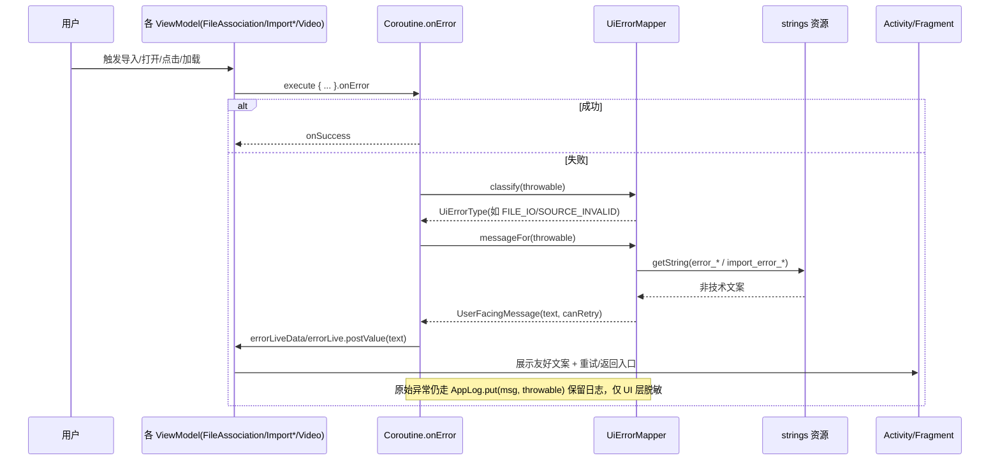
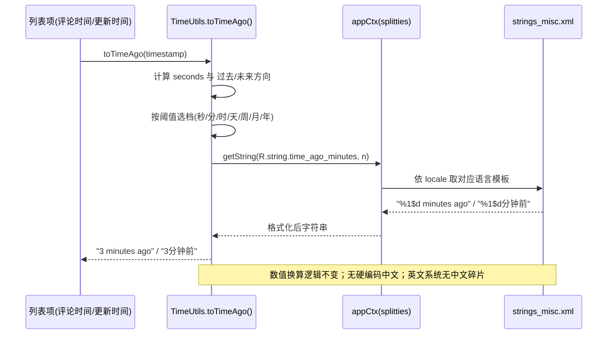
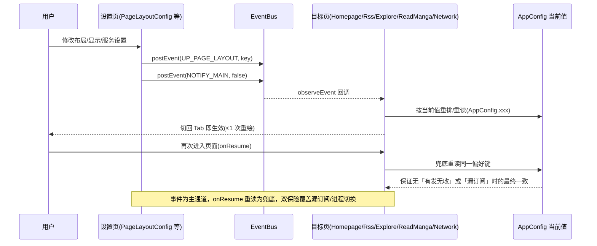

# 软件使用体验优化 —— 系统设计与任务分解

> 项目：LegadoH（开源阅读类 Android 应用）
> 范围：应用整体（书架 / 发现 / 阅读 / 设置 / 导入 / 视频等页面）
> 架构师：高见远
> 性质：系统设计文档（不写实现代码）
> 上游输入：《软件使用体验优化 PRD》（P0-1 ~ P2-3 编号）

---

## 1. 实现方案总览

围绕 PRD 的三条主线 + 一条全局联动线，沿「最小变更 + 复用既有设施 + 抽薄共享层」的原则落地，**不推翻、不重写**既有 View/XML 与 Compose 混用的架构。

| 主线 | 对应 PRD | 方案要点 |
| --- | --- | --- |
| ① 视觉与交互一致 | P1-1、P1-2、P2-1、P2-2 | 设计规范审计清单化；背景图可读性全站补齐；玻璃参数统一描述；主题预览与实装共用同一配置解析 |
| ② 稳定与容错 | P0-1、P0-2、P1-4 | 建立**全应用共享**的 `Exception → 用户文案` 映射层；相对时间抽入 `strings.xml`；清理数据/工具层残留硬编码中文 |
| ③ 流畅度与性能 | P0-3、P1-3 | 毛玻璃 `draw()` 逐帧 `getLocationOnScreen` 改为位置缓存驱动 + 低端机自动降级；列表项绑定做内容签名 diff |
| ④ 全局联动一致 | P0-4、P2-3 | 关键事件统一「事件 + onResume 重读」双保险；`EventBus` 常量补 KDoc 发布/订阅对；设置搜索 CI 门禁 |

**核心取舍**：
1. **异常映射层只造一套**（关键决策）：发现页架构设计里的 `DiscoveryErrorMapper` 本轮**升级并合并为全应用共享的 `UiErrorMapper`**，发现页与导入/视频/文件关联等全部复用同一「异常分类核心」，各页面仅保留自己的上下文文案（`discovery_error_*` / `error_*` / `import_error_*`）。**不允许存在两套异常分类逻辑。**
2. **不 Compose 化 View/XML 页面**：发现页经典模式、文件关联、视频播放等 View 体系页面只做降级与文案替换，不迁移 Compose（收益低、风险高）。
3. **不引入新第三方依赖**：位置缓存、低端降级、签名 diff、超时全用现有协程/Compose/RecyclerView 能力；Macrobenchmark 仅作为**可选开发期回归**，默认不进 CI 门禁（见待明确事项 7）。
4. **426 处 `localizedMessage` 分口径处置**：PRD 明确「日志/AppLog 除外」。426 处中绝大多数是 `AppLog.put(... localizedMessage ...)` 日志路径（豁免）；真正**用户可见直出**的集中在导入/文件关联/视频/发现页 catch 分支，T02 全覆盖这些点，日志路径不强制改。

---

## 2. 框架 / 技术选型

| 关注点 | 选型 | 理由 |
| --- | --- | --- |
| 语言/UI | Kotlin + View/XML（经典/导入/视频）+ Compose（现代/套件/设置） | 贴合现状，不新增范式 |
| 异常映射 | 新建纯 Kotlin `object UiErrorMapper`（无框架依赖）+ `enum UiErrorType` | 可单测，View/Compose 双端共用 |
| 相对时间 | `appCtx.getString` + `%1$d` 位置参数（splitties `appCtx` 已全局可用） | 保持数值换算逻辑不变，仅文案外置 |
| 毛玻璃位置缓存 | `View.OnLayoutChangeListener` + `OnScrollChangedListener` + `OnAttachStateChangeListener`，缓存 `IntArray` 位置比对 | 不引入新依赖；仅在位置真正变化时重算 shader matrix |
| 设备性能分级 | 复用 `AppConfig.isEInkMode` + `ActivityManager.isLowRamDevice` | 不引入性能检测 SDK |
| 列表签名 diff | 延续 `discoverBooksSignature` 思路（内容签名比对避免无谓重组） | 现有模式 |
| 事件双保险 | `postEvent`/`observeEvent`（LiveEventBus 体系）+ Fragment `onResume` 重读 | 全为既有设施 |
| 设置搜索保障 | `tools/check_settings_mapping.py` + `tools/check_r58_resources.py` | 既有工具，仅补 CI 调用 |
| 性能基线 | 可选 Macrobenchmark / FrameTiming（开发期手动回归） | 默认不进 CI，成本可控 |

**是否引入新第三方依赖**：**否**。全部基于现有 `build.gradle` 依赖集。

---

## 3. 文件列表

### 3.1 新增文件

| 相对路径 | 职责 |
| --- | --- |
| `app/src/main/java/io/legado/app/ui/common/UserFacingError.kt` | `UiErrorType` 枚举 + `UiErrorMapper` 映射核心 + `UserFacingMessage` 结果模型 |

> 注：发现页架构设计中原 `ui/main/explore/DiscoveryErrorMapper.kt` **不再单独新增**，其分类职责并入上述共享 `UiErrorMapper`；`DiscoveryErrorType` 收敛为 `UiErrorType` 子集（迁移映射见 §4.2）。

### 3.2 修改文件

| 相对路径 | 涉及 PRD | 改动点 |
| --- | --- | --- |
| `app/src/main/res/values/strings_misc.xml`（及 `values-zh`、`values-zh-rTW`、`values-zh-rHK` 等） | P0-1、P0-2 | 新增 `error_*` 通用文案、`time_ago_*`/`time_later_*` 相对时间模板 |
| `app/src/main/java/io/legado/app/utils/TimeUtils.kt` | P0-2、P1-4 | `Long.toTimeAgo()` 改为资源拼接，移除硬编码中文 |
| `app/src/main/java/io/legado/app/constant/EventBus.kt` | P0-4 | 补全 4 个关键常量的 KDoc（发布方/订阅方清单） |
| `app/src/main/java/io/legado/app/ui/association/FileAssociationViewModel.kt` | P0-1、P1-4 | 去掉「无法打开文件\nlocalizedMessage」拼接，改 `UiErrorMapper` |
| `app/src/main/java/io/legado/app/ui/association/ImportBookSourceViewModel.kt` | P0-1 | 去掉 `ImportError:localizedMessage`，改 `UiErrorMapper` |
| `app/src/main/java/io/legado/app/ui/association/ImportDictRuleViewModel.kt` 等其余 6 个 Import* | P0-1 | 同上，统一改映射层 |
| `app/src/main/java/io/legado/app/ui/association/OnLineImportViewModel.kt`、`OnLineImportActivity.kt` | P0-1 | 导入失败文案脱敏 |
| `app/src/main/java/io/legado/app/ui/video/VideoPlayerViewModel.kt` | P0-1 | 去掉 `$name click error\nlocalizedMessage`，改映射层 |
| `app/src/main/java/io/legado/app/ui/main/explore/ExploreFragment.kt` | P0-1、P0-4、P1-3 | `loadDiscoverBooks` catch 改映射层；订阅 `UP_PAGE_LAYOUT` 双保险；签名 diff |
| `app/src/main/java/io/legado/app/ui/main/explore/ExploreGlassBackdrop.kt` | P0-3、P2-1 | `FrostedGlassDrawable` 位置缓存 + 低端降级 + 玻璃参数统一描述 |
| `app/src/main/java/io/legado/app/ui/main/explore/ExploreAdapter.kt` | P0-3 | 滚动回调接线，`rowBackground` 减负 |
| `app/src/main/java/io/legado/app/ui/widget/StableLiquidGlassView.kt` | P2-1 | `rebuildGlass` 异常兜底加固 + 参数对齐统一玻璃描述 |
| `app/src/main/java/io/legado/app/ui/config/PageLayoutConfigFragment.kt` | P0-4 | 发布对确认（已发 `UP_PAGE_LAYOUT`+`NOTIFY_MAIN`） |
| `app/src/main/java/io/legado/app/ui/main/homepage/HomepageFragment.kt` | P0-4 | `UP_PAGE_LAYOUT` 订阅 + `onResume` 重读双保险 |
| `app/src/main/java/io/legado/app/ui/main/rss/RssFragment.kt` | P0-4 | 同上 |
| `app/src/main/java/io/legado/app/ui/book/manga/ReadMangaActivity.kt` | P0-4 | `UP_MANGA_DISPLAY` 订阅 + `onResume` 重读双保险 |
| `app/src/main/java/io/legado/app/ui/config/NetworkConfigFragment.kt` | P0-4 | `WEB_SERVICE` 订阅 + `onResume` 重读双保险 |
| `app/src/main/java/io/legado/app/ui/widget/compose/AppSettingComponents.kt`、`AppComposeDialogs.kt` | P1-1 | 规范审计基线（如发现缺口补入） |
| `app/src/main/java/io/legado/app/ui/widget/compose/BackgroundReadability.kt` | P1-2 | 投影/衬底参数统一（深浅色自适应） |
| 书架/目录/阅读记录/RSS/搜索相关列表页 | P1-2 | 补齐 `imageBgTextShadow` / `imageBgScrimColor` 接入 |
| `app/src/main/java/io/legado/app/ui/config/ThemeManageActivity.kt`、`app/src/main/java/io/legado/app/help/config/ThemeConfig.kt` | P2-2 | 预览与实装共用同一 `ThemeConfig`/`ThemeRuntimeKeys` 解析 |
| `tools/check_settings_mapping.py`、`tools/check_r58_resources.py` | P2-3 | 接入 CI 回归；新增设置页强制 `searchKeys` 齐全 |
| `app/src/main/java/io/legado/app/ui/config/SettingsSearchIndex.kt` | P2-3 | 索引构建契约说明（不强制改代码） |

---

## 4. 数据结构与接口

### 4.1 类图

```mermaid
classDiagram
    class UiErrorType {
        <<enum>>
        NETWORK
        TIMEOUT
        PARSE_FORMAT
        SOURCE_INVALID
        FILE_IO
        FILE_UNSUPPORTED
        NO_DATA
        UNKNOWN
    }

    class UserFacingMessage {
        +text: String
        +canRetry: Boolean
        +errorType: UiErrorType
    }

    class UiErrorMapper {
        <<object>>
        +classify(t: Throwable): UiErrorType
        +message(type: UiErrorType): UserFacingMessage
        +messageFor(t: Throwable): UserFacingMessage
        +retryable(type: UiErrorType): Boolean
    }

    class TimeUtils {
        +Long.toTimeAgo(): String
        +Int.toDurationTime(): String
    }

    class FrostedGlassDrawable {
        +onPositionChanged(left: Int, top: Int, rootLeft: Int, rootTop: Int)
        +updateBackdrop(bitmap: Bitmap?)
        +draw(canvas: Canvas)
        -cachedLocation: IntArray?
        -shaderMatrix: Matrix
        -location: IntArray
        -rootLocation: IntArray
    }

    class GlassPositionTracker {
        +attach(host: View, drawable: FrostedGlassDrawable)
        +detach()
        -nearestScrollableAncestor(host: View): View?
    }

    class ExploreGlassBackdrop {
        +level(context: Context): Int
        +rowBackground(host: View, level: Int): Drawable?
        +shouldDowngrade(context: Context): Boolean
    }

    class EventBus {
        <<object>>
        +UP_PAGE_LAYOUT: String
        +UP_MANGA_DISPLAY: String
        +WEB_SERVICE: String
        +NOTIFY_MAIN: String
    }

    class PageLayoutConfigFragment {
        +post UP_PAGE_LAYOUT + NOTIFY_MAIN
    }
    class HomepageFragment {
        +observeLiveBus(): observe UP_PAGE_LAYOUT
        +onResume(): 重读 AppConfig.homepageLayoutMode
    }
    class RssFragment {
        +observeLiveBus(): observe UP_PAGE_LAYOUT
        +onResume(): 重读 AppConfig.rssSourceLayout
    }
    class ReadMangaActivity {
        +observeEvent(UP_MANGA_DISPLAY)
        +onResume(): 重读显示参数
    }
    class NetworkConfigFragment {
        +observeEvent(WEB_SERVICE)
        +onResume(): 重读 web 服务状态
    }

    UiErrorMapper --> UiErrorType
    UiErrorMapper --> UserFacingMessage
    FrostedGlassDrawable --> GlassPositionTracker
    ExploreGlassBackdrop --> FrostedGlassDrawable
    HomepageFragment --> EventBus
    RssFragment --> EventBus
    ReadMangaActivity --> EventBus
    NetworkConfigFragment --> EventBus
    PageLayoutConfigFragment --> EventBus
```



### 4.2 关键接口说明

**`UiErrorMapper`（全应用唯一异常分类核心）**
- `classify(t)`：按 `IOException/SocketTimeoutException` → `NETWORK`；`TimeoutCancellationException`/超时封装异常 → `TIMEOUT`；`JsonParse/JsonPath/格式校验失败` → `PARSE_FORMAT`；`ERROR:` 前缀/书源失效 → `SOURCE_INVALID`；`FileNotFoundException/IO 读文件失败` → `FILE_IO`；不支持的扩展名 → `FILE_UNSUPPORTED`；空结果（由状态机判断，非异常）→ `NO_DATA`；其余 → `UNKNOWN`。
- `messageFor(t)`：返回 `UserFacingMessage(text, canRetry, type)`，**任何路径都不返回 `t.localizedMessage`**。
- `message(type)`：返回该类型的**通用默认文案**（`error_network` 等）；各页面如需更具体的上下文文案，用 `classify(t)` 得到的 `type` 自行取 `discovery_error_*` / `import_error_*` 等专属 key，但**不再各自写分类逻辑**。

**与发现页 `DiscoveryErrorMapper` 的迁移映射（避免两套）**：

| 原 `DiscoveryErrorType`（发现页文档） | 统一后 `UiErrorType` | 说明 |
| --- | --- | --- |
| `NETWORK` | `NETWORK` | 一致 |
| `TIMEOUT` | `TIMEOUT` | 一致 |
| `SOURCE_INVALID` | `SOURCE_INVALID` | 一致 |
| `NO_DATA` | `NO_DATA` | 一致（状态非异常） |
| `UNKNOWN` | `UNKNOWN` | 一致 |
| （新增） | `PARSE_FORMAT` / `FILE_IO` / `FILE_UNSUPPORTED` | 导入/文件关联/视频新增 |

发现页实现时**直接 import 共享 `UiErrorMapper`**，其专属文案仍走 `discovery_error_*` key；原 `DiscoveryErrorMapper.kt` 不再落地（或仅保留一行 `typealias DiscoveryErrorType = UiErrorType` 的过渡别名，不建议保留文件）。

**`FrostedGlassDrawable` 位置缓存**
- 构造后由 `GlassPositionTracker.attach()` 挂接 `OnLayoutChangeListener`（host 自身）与 `OnScrollChangedListener`（向上寻找到的最近 `RecyclerView/NestedScrollView/ScrollView` 祖先）。
- `onPositionChanged(left, top, rootLeft, rootTop)` 先与 `cachedLocation` 比对，未变则直接 return；变化时更新缓存、重算 `shaderMatrix`、`shader?.setLocalMatrix`、`invalidateSelf()`。
- `draw()` **不再调用 `getLocationOnScreen`**，仅用已缓存的 matrix；首次缓存为空时惰性采样一次。

**`TimeUtils.toTimeAgo()`**
- 保留现有数值换算（秒/分/时/天/周/月/年阈值不变），仅把「数值+单位+前/后」的拼接改为 `appCtx.getString(R.string.time_ago_seconds, n)` 等模板。
- 关键资源 key（default 英文 + `values-zh` 中文）：

| key | 默认（values） | 中文（values-zh） |
| --- | --- | --- |
| `time_ago_seconds` | `%1$d seconds ago` | `%1$d秒前` |
| `time_ago_minutes` | `%1$d minutes ago` | `%1$d分钟前` |
| `time_ago_hours` | `%1$d hours ago` | `%1$d小时前` |
| `time_ago_days` | `%1$d days ago` | `%1$d天前` |
| `time_ago_weeks` | `%1$d weeks ago` | `%1$d周前` |
| `time_ago_months` | `%1$d months ago` | `%1$d月前` |
| `time_ago_years` | `%1$d years ago` | `%1$d年前` |
| `time_later_seconds` | `in %1$d seconds` | `%1$d秒后` |
| `time_later_minutes` | `in %1$d minutes` | `%1$d分钟后` |
| `time_later_hours` | `in %1$d hours` | `%1$d小时后` |
| `time_later_days` | `in %1$d days` | `%1$d天后` |
| `time_later_weeks` | `in %1$d weeks` | `%1$d周后` |
| `time_later_months` | `in %1$d months` | `%1$d月后` |
| `time_later_years` | `in %1$d years` | `%1$d年后` |

> 采用 14 个完整模板（单位+方向合一）而非「单位 + 前/后」拆分，是为了正确表达英文「ago 后置 / in 前置」的语序差异。其余 locale（es/ja/pt/vi）默认回退到 values 英文，待后续补充翻译。

---

## 5. 程序调用流程

### 5.1 异常降级链路（导入/文件关联/视频/发现页通用）



### 5.2 相对时间本地化链路



### 5.3 事件即时生效链路（事件 + onResume 双保险）



---

## 6. 任务列表（有序、含依赖）

> 任务按「共享底座 → 三主线 + 全局联动」划分；每任务至少覆盖 3 个文件；除 T01 外均只依赖 T01，可并行，减少线性依赖链。`ExploreFragment.kt` 被 T02/T03/T04 修改，建议按顺序合入避免冲突。

### T01 共享能力底座：通用异常映射层 + 相对时间资源 + 事件常量规范
- **PRD**：P0-1（底座）、P0-2（资源）、P0-4（KDoc 规范）
- **文件**：
  - 新增 `app/src/main/java/io/legado/app/ui/common/UserFacingError.kt`
  - 修改 `app/src/main/res/values/strings_misc.xml`（`error_*` + `time_ago_*`/`time_later_*`）
  - 修改 `app/src/main/res/values-zh/strings_misc.xml`（中文，`values-zh-rTW`/`values-zh-rHK` 同步或回退）
  - 修改 `app/src/main/java/io/legado/app/constant/EventBus.kt`（补 4 个常量 KDoc 发布/订阅方）
- **依赖**：无
- **验收**：
  - `UiErrorMapper.classify` 对八类异常返回正确 `UiErrorType`，`messageFor` 输出不含 `localizedMessage`；
  - 14 个 `time_ago_*`/`time_later_*` key 在 default 与 values-zh 齐备，`%1$d` 位置参数无错配；
  - `EventBus` 四个常量 KDoc 写清「谁发、谁收」，可编译。

### T02 稳定容错主线：异常去技术化全量接入 + 相对时间落地
- **PRD**：P0-1、P0-2、P1-4
- **文件**：
  - 修改 `app/src/main/java/io/legado/app/utils/TimeUtils.kt`
  - 修改 `app/src/main/java/io/legado/app/ui/association/FileAssociationViewModel.kt`
  - 修改 `app/src/main/java/io/legado/app/ui/association/ImportBookSourceViewModel.kt`
  - 修改 `app/src/main/java/io/legado/app/ui/association/ImportDictRuleViewModel.kt` / `ImportHttpTtsViewModel.kt` / `ImportReplaceRuleViewModel.kt` / `ImportThemeViewModel.kt` / `ImportTxtTocRuleViewModel.kt` / `ImportRssSourceViewModel.kt`（Import* 系列）
  - 修改 `app/src/main/java/io/legado/app/ui/association/OnLineImportViewModel.kt` / `OnLineImportActivity.kt`
  - 修改 `app/src/main/java/io/legado/app/ui/video/VideoPlayerViewModel.kt`
  - 修改 `app/src/main/java/io/legado/app/ui/main/explore/ExploreFragment.kt`（`loadDiscoverBooks` catch）
- **依赖**：T01
- **验收**：
  - UI 层用户可见路径不再出现 `localizedMessage` 直出（日志/AppLog 豁免）；`FileAssociationViewModel` L60、`VideoPlayerViewModel` L93、`Import*` 的 `ImportError:` 前缀、`ExploreFragment` L3577 全部改映射层；
  - `toTimeAgo()` 英文系统输出英文、中文系统输出中文，无中文碎片；
  - 复用 `tools/i18n_batch.py` classify 口径回归，真实可见中文候选保持 0。

### T03 性能流畅主线：毛玻璃位置缓存 + 低端降级 + 滚动签名基线
- **PRD**：P0-3、P1-3、P2-1
- **文件**：
  - 修改 `app/src/main/java/io/legado/app/ui/main/explore/ExploreGlassBackdrop.kt`
  - 修改 `app/src/main/java/io/legado/app/ui/main/explore/ExploreAdapter.kt`
  - 修改 `app/src/main/java/io/legado/app/ui/widget/StableLiquidGlassView.kt`
  - 修改 `app/src/main/java/io/legado/app/ui/main/explore/ExploreFragment.kt`（内容签名 diff，如 `syncDiscoverComposeState`）
- **依赖**：T01
- **验收**：
  - `FrostedGlassDrawable.draw()` 不再逐帧 `getLocationOnScreen`，位置缓存命中时仅复用 matrix；
  - `GlassPositionTracker` 正确挂接滚动/布局/attach 回调并随视图销毁解绑（无泄漏）；
  - `level()` 在 `isEInkMode` 或 `isLowRamDevice` 时降级为实底/关闭，无异常；
  - 列表绑定按内容签名 diff，滚动 Jank 无新增回归。

### T04 全局联动主线：事件双保险 + 设置搜索 CI 保障
- **PRD**：P0-4、P2-3
- **文件**：
  - 修改 `app/src/main/java/io/legado/app/ui/config/PageLayoutConfigFragment.kt`
  - 修改 `app/src/main/java/io/legado/app/ui/main/homepage/HomepageFragment.kt`
  - 修改 `app/src/main/java/io/legado/app/ui/main/rss/RssFragment.kt`
  - 修改 `app/src/main/java/io/legado/app/ui/main/explore/ExploreFragment.kt`（`UP_PAGE_LAYOUT` 订阅 + onResume 重读）
  - 修改 `app/src/main/java/io/legado/app/ui/book/manga/ReadMangaActivity.kt`（`UP_MANGA_DISPLAY` 双保险）
  - 修改 `app/src/main/java/io/legado/app/ui/config/NetworkConfigFragment.kt`（`WEB_SERVICE` 双保险）
  - 修改 `tools/check_settings_mapping.py` / `tools/check_r58_resources.py`（CI 门禁调用）
- **依赖**：T01
- **验收**：
  - `UP_PAGE_LAYOUT` / `UP_MANGA_DISPLAY` / `WEB_SERVICE` 三对事件均有发有收，无悬空事件；
  - 改设置切回页面 ≤1 次重绘即生效（事件通道），重进页面 onResume 兜底重读保证最终一致；
  - 设置搜索无死结果、新增设置项自动进索引。

### T05 视觉一致主线：设计规范审计 + 背景图可读性 + 主题预览一致
- **PRD**：P1-1、P1-2、P2-2
- **文件**：
  - 修改 `app/src/main/java/io/legado/app/ui/widget/compose/AppSettingComponents.kt` / `AppComposeDialogs.kt`（审计基线，缺口补齐）
  - 修改 `app/src/main/java/io/legado/app/ui/widget/compose/BackgroundReadability.kt`（投影/衬底参数统一）
  - 修改 书架/目录/阅读记录/RSS/搜索相关列表页（接入 `imageBgTextShadow`/`imageBgScrimColor`）
  - 修改 `app/src/main/java/io/legado/app/ui/config/ThemeManageActivity.kt` / `app/src/main/java/io/legado/app/help/config/ThemeConfig.kt`（预览与实装共用解析）
- **依赖**：T01
- **验收**：
  - 存量/新增 Compose 页面均引用 `AppSettingPalette` / `AppDialogStyle`，同屏无新旧样式混用；
  - README 所列页面在复杂背景图下文字可读，未开背景图时无投影/衬底（观感不变）；
  - 主题预览与实装效果一致，切换主题无残留旧配色。

---

## 7. 依赖包列表

**无新增第三方依赖。** 全部复用现有依赖与工具：

```
- kotlinx-coroutines（现有）: 协程/onError 回调体系
- androidx.compose（现有）: animation / runtime / material3
- androidx.recyclerview（现有）: RecyclerView.OnScrollListener
- splitties.init（现有）: appCtx 全局 Context
- Android ActivityManager（系统）: isLowRamDevice 低端降级
- tools/*.py（现有）: check_settings_mapping / check_r58_resources / i18n_batch
- 可选（开发期）: Macrobenchmark / FrameTiming（默认不进 CI）
```

---

## 8. 共享知识（跨文件约定）

- **命名前缀**：通用异常层统一 `UiError*`（`UiErrorType` / `UiErrorMapper` / `UserFacingMessage`）；通用文案 key 统一 `error_*`、相对时间 key 统一 `time_ago_*` / `time_later_*`；发现页专属文案沿用 `discovery_error_*`，导入专属可加 `import_error_*`（如确有上下文差异）。
- **错误码（枚举）唯一性**：全项目**只有** `UiErrorType` 一个异常分类枚举。发现页/导入/文件/视频均 import `io.legado.app.ui.common.UiErrorMapper`，禁止在 UI 层再写 `when (e is IOException)` 式分类，禁止拼 `e.localizedMessage`。
- **日志与 UI 分离**：`AppLog.put(..., throwable)` 可保留原始异常用于排障；**用户可见层**（`errorLiveData`/`toastOnUi`/`tvDiscoverEmpty.text` 等）一律走 `UiErrorMapper`。
- **线程模型**：
  - 异常分类 `classify` 为纯函数，任意线程可调；
  - `toTimeAgo()` 在主线程调用，内部 `appCtx.getString` 线程安全；
  - 毛玻璃位图构建仍 `Dispatchers.IO` + 按 key 去重（`inFlightKeys`/`pendingCallbacks` 不变），位置采样/缓存更新在**主线程**回调中执行。
- **事件常量规范**：`EventBus` 中每个被跨页订阅的常量 KDoc 必须标注「发布方 + 订阅方 + payload 类型」；新增事件必须先声明订阅方再发布，禁止「有发无收」。
- **双保险模式**：关键布局/显示/服务类设置统一「事件即时刷新 + `onResume` 重读兜底」；事件回调内判 `!isAdded || view == null` 再 return（沿用现有模式）。
- **设置搜索契约**：各设置页 `buildSpec()` 必须只依赖 `Context`（`ctx`/`str()`），不得碰 `requireActivity()`/`parentFragmentManager`/`view`；新增设置项必须带全 `searchKeys` 别名。
- **国际化口径**：用户可见文案零硬编码中文；`tools/i18n_batch.py classify` 真实可见候选保持 0；相对时间采用 14 个完整模板表达语序差异。

---

## 9. 待明确事项（技术侧风险与需确认点）

1. **异常文案口径**（PRD 待确认 1）：是否所有 `ImportError:` / `load error` 统一为「导入失败 / 加载失败，点击重试」，还是保留「长按查看技术详情」折叠入口供排查书源。技术上容易（复用 `TextDialog`），只影响交互与映射表措辞。
2. **毛玻璃自动降级边界**（PRD 待确认 2）：本方案按 `isEInkMode` + `isLowRamDevice` 自动降级为实底/关闭，会牺牲部分视觉一致。是否接受自动档，还是保留用户手动档优先。
3. **相对时间格式**（PRD 待确认 3）：本方案 default 英文采用完整写法 `3 seconds ago`。若客户偏好简写 `3s ago`，只需替换 §4.2 模板文本，结构不变。
4. **视觉规范强制范围**（PRD 待确认 4）：T05 按「存量补齐 + 新页强制」处理；是否要求存量页面在本轮全部迁移，影响 T05 文件范围与工作量。
5. **背景图可读性覆盖面**（PRD 待确认 5）：本方案覆盖 README 所列页面；书源编辑、导入弹窗等是否也加投影/衬底需确认。
6. **事件联动幅度**（PRD 待确认 6）：本方案统一「事件 + onResume 重读」双保险；是否维持「重读兜底为主」需确认，双保险是推荐项。
7. **性能回归基线**（PRD 待确认 7）：本方案默认 Macrobenchmark 只做开发期手动回归，不进 CI；若要 CI 门禁需评估设备与耗时成本。
8. **第三方 LiquidGlass 取舍**（PRD 待确认 8）：本方案继续用 `StableLiquidGlassView` 稳定壳 + 兜底加固；是否自绘玻璃替换第三方依赖（工作量大、风险高），建议暂缓。
9. **技术风险**：`ExploreFragment.kt`（约 4157 行）被 T02/T03/T04 连续修改，存在合并冲突面。建议工程师按任务顺序单点提交、每任务自测后合入。
10. **迁移一致性**：发现页架构设计文档中的 `DiscoveryErrorMapper` 相关任务（T01/T02/T03）实现时以本文 §4.2 共享层为准，需同步修订发现页文档避免「两套映射层」描述残留。

---

*文档结束。*
